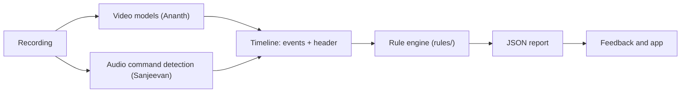

# The ARTS rule engine: documentation index

**Owner:** Arnikan (annotation lead and rule engine lead) · **Updated:** 2026-11-24

## What the rule engine is
ARTS records a learner performing defibrillation on a training mannequin. The video models
(Ananth) and the audio command detection (Sanjeevan) turn the recording into **events**: "gel applied",
"shock shown on the screen", "stand clear" said, and so on. The **rule engine** takes these events,
merged into one **timeline**, and decides rule by rule whether each step of the procedure was done
correctly, then gives one overall result with its reasons. It never looks at video or audio itself:
it sees only the events and a **header** saying what could be observed, and when.

The code is in `rules/`, the settings in `configs/rules.yaml` and `configs/rule_engine/`, the tests in
`tests/test_rule_engine_*.py`. Start with the **work report**.

## Readable overviews (start here)

| Document | What it is for | Who should read it |
|---|---|---|
| [rule_engine_report.md](rule_engine_report.md) | The complete work report: purpose, how it works, the rules, the policies, testing, what is needed from each teammate | Ananth, Sanjeevan, the lecturers, anyone new |
| [procedure.md](procedure.md) | The procedure the engine follows: every step, its evidence and rule, and the open questions about the procedure | Everyone; the medical supervisor to confirm the order |
| [open_questions_summary.md](open_questions_summary.md) | Every open question in one table, by who must answer, with what the engine does meanwhile | The supervisor, Sanjeevan, Ananth |
| [supervisor_briefing.md](supervisor_briefing.md) | A briefing for the supervisor meeting: the design policies, the built rules, the departures from the proposal | The medical supervisor |
| [demo_walkthrough.md](demo_walkthrough.md) | How to run and present the demo (`python -m rules.demo`), scenario by scenario | Presenters, the team |
| [rules_status.md](rules_status.md) | Each rule's logic in plain words, its status and what it waits on | Everyone tracking progress |
| [upstream_requirements.md](upstream_requirements.md) | What the rule engine needs from the video and audio pipelines, with priorities | Ananth, Sanjeevan |
| [output_contract.md](output_contract.md) | The JSON report the feedback module receives: fields, codes, versions | Sanjeevan (feedback and app) |
| [camera_angle_evidence.md](camera_angle_evidence.md) | Which camera view shows which step | The team, the supervisor |

## Reference registers (look things up)

| Document | What it holds |
|---|---|
| [decisions.md](decisions.md) | Every decision (D-), with its reason and status; IDs are stable |
| [open_questions.md](open_questions.md) | Every open question (OQ-) with its full history; [the summary](open_questions_summary.md) is the readable form |
| [assumptions.md](assumptions.md) | The working assumptions (A-), such as A-027 (which tag means which paddle) |
| [decision_flow.yaml](decision_flow.yaml) | Every decision point (P-) as data: conditions, outcomes, codes, flags; checked against the code by a test |
| [pathways.md](pathways.md) | The decision points as tables, and worked examples (W-) |
| [diagrams.md](diagrams.md) | Mermaid diagrams of the flow and of each rule |
| [anomalies.md](anomalies.md) | Every rejection, anomaly, flag and failure code |
| [methods.md](methods.md) | The engine's architecture and the methods behind it |

## Plans and logs

| Document | What it holds |
|---|---|
| [implementation_plan.md](implementation_plan.md) | The original build plan: Increments 0–17 and the annotation steps 9a–9d (its audio increments were superseded by the audio integration plan, D-120) |
| [audio_integration_plan.md](audio_integration_plan.md) | The plan for the audio rules and the combined flow (Increments 18–28, all built) |
| [progress.md](progress.md) | The history of every increment, with its tests and results |
| [agent_brief.md](agent_brief.md) | The brief and hard constraints given to the AI coding agent |
| [ai_usage_log.md](ai_usage_log.md) | How AI was used, what it produced, and what Arnikan decided (AIAS Level 3) |
| [demo/scenarios/](demo/scenarios/) | The demo's synthetic timelines and their expected results |

A docs test (`tests/test_rule_engine_docs.py`) keeps the registers, the decision flow, the output
contract and procedure.md consistent with the code and the config.
