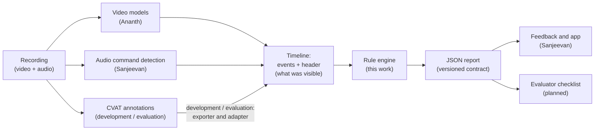
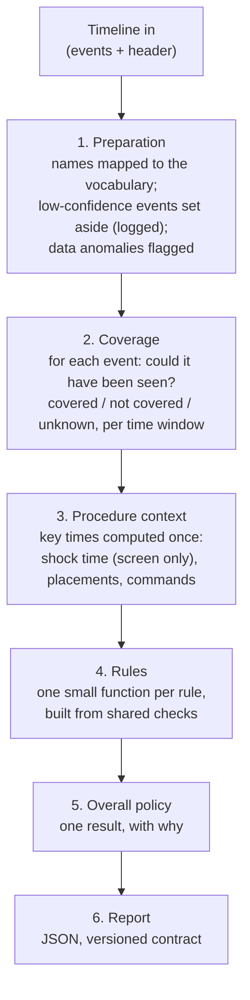

# Rule engine: demo walkthrough

**For:** the team today, and the supervisor meeting in three days · **From:** Arnikan ·
**Date:** 2026-10-17 · **Reading time:** about 15–20 minutes

This is a guide for presenting the rule engine as it stands. It covers the overall workflow and
the key details. The detailed documents are linked rather than repeated:

| Topic | Document |
|---|---|
| Every decision | [decisions.md](decisions.md) |
| Every decision point and worked pathway | [decision_flow.yaml](decision_flow.yaml), [pathways.md](pathways.md) |
| The diagrams | [diagrams.md](diagrams.md) |
| What the feedback module receives | [output_contract.md](output_contract.md) |
| Each rule's status | [rules_status.md](rules_status.md) |
| Supervisor questions | [supervisor_briefing.md](supervisor_briefing.md) |

---

## 1. What the rule engine does, and where it sits

ARTS records a learner performing defibrillation on a training mannequin. Video and audio models
(and, for now, human annotators) turn the recording into **events**: "gel applied", "apical
paddle placed", "shock shown on the screen", "stand clear" said, and so on. The rule engine takes
these events and decides, rule by rule, whether each step of the procedure was done correctly. It
then gives one overall result with its reasons.



The rule engine never looks at pixels or audio. It sees only events and a **header** saying
what could be observed: for example, whether the screen or a placement zone was in view, and
when. Telling "it didn't happen" from "it couldn't be seen" is the heart of the design.
Full flow: [diagram (a)](diagrams.md#a-end-to-end-from-recording-to-report).

## 2. The engine's stages



- **Preparation** rejects malformed input outright, so no report is produced. It flags data
  problems, such as two shocks or a paddle identity swap, for review. These never fail the
  learner by themselves.
- **Coverage** is one configurable policy. Rules never decide what missing evidence means.
- **Context** computes the shock time and other anchors once, so every rule uses the same
  values.
- **Rules** register themselves. Adding a rule needs no engine change, and every rule is always
  evaluated (no stopping at the first mistake).

Detailed version: [diagram (b)](diagrams.md#b-inside-the-rule-engine) and
[the steps every rule follows](diagrams.md#c-the-decision-ladder-every-rule-follows-p-026-p-014).

## 3. The possible results

**Per rule:**

| Result | Meaning |
|---|---|
| **Pass – Direct** | The step was seen done correctly |
| **Pass – Inferred** | Not seen directly, but shown by an approved inference (for example, a confirmed shock shows the paddles were on the chest) |
| **Fail** | The evidence clearly shows the mistake. The result always names it (a *failure code*, such as `removed_before_shock`) |
| **Unable to Verify** | The evidence can't settle it: the area wasn't visible, the detection was low-confidence, or the evidence contradicts itself |
| **Not evaluable because of X** | It depends on something missing that another rule reports (for example no shock time → "because of R5"). A mistake in one step is never evidence of a mistake in another; the parts that can still be judged are checked (D-119) |
| **Pending** | The rule's definition is not yet approved by the supervisor |

Results also carry **flags** that explain them, for example:
- `timing_not_checked`: no clinical time limit was given yet;
- `derived_placement`: the result rests on a placement derived from the annotated boxes;
- `possible_parallel_placement`: one action caused two failures.

**Overall**, applied in this order ([diagram (g)](diagrams.md#g-overall-result-p-017-built)):
1. **Any Fail → Fail.** Every mistake is listed.
2. Otherwise, **anything incomplete → Incomplete, never Pass**:
   - a pending rule;
   - a time limit not given yet, or an order requirement not set;
   - an assumed result;
   - data that needs review.
3. Otherwise, **anything Unable to Verify or Not evaluable** → a setting not yet decided by the
   supervisor: Fail, or "faculty review" (OQ-002). Until then it is reported as
   `unable_to_verify`.
4. Otherwise **Pass**. A Pass means every step was actually checked.

## 4. The demo

All commands run from the repository root in the project's `.venv`.

```powershell
.venv\Scripts\python -m rules.demo                       # all seven scenarios
.venv\Scripts\python -m rules.demo --scenario <id>       # one scenario
.venv\Scripts\python -m rules.demo --scenario <id> --full  # with whole reasons
```

**What the demo runs:**
- **Scenarios:** seven synthetic timelines in [demo/scenarios/](demo/scenarios/), with no
  participant data. Each is listed with its expected results in
  [scenarios.yaml](demo/scenarios/scenarios.yaml).
- **Config:** [configs/rule_engine/demo/rules_demo.yaml](../../configs/rule_engine/demo/rules_demo.yaml).
  It is a copy of the real catalogue in which the seven built rules are marked approved and the
  unbuilt audio rules are disabled. **DEMO ONLY: the rules are not approved by the supervisor.**
  Every report it produces says so, with the flag `demo_only` (D-114).
- **Output:** each scenario prints a table (rule, result, failure code, flags, short reason), the
  overall result and why, and whether it matched the expected result. A test checks that every
  scenario keeps its expected results, so the demo can't silently break.

Every scenario uses the same procedure, timed in seconds:
1. Gel on the apical zone (3 s) and the sternal zone (5 s).
2. Apical paddle taken (7 s, `first_paddle_taken`) and placed (9 s), sternal paddle taken (10 s,
   `second_paddle_taken`) and placed (12 s).
3. Both paddles firmly on the chest (12.5 s), buttons pressed (14 s).
4. Shock on the screen (15 s), paddles removed (17 s).

Each scenario changes one thing.

### Scenario 1: a correct procedure (`correct_procedure`)
**Shows:** every built rule passes, but the overall result is **Incomplete**. Some clinical
settings are not decided yet: no time limit for gel (R1) or removal (R6), and R5's preceding steps
not set. A Pass must mean everything was checked.
```
  R1 Gel applied twice             Pass  ...  timing_not_checked  gel applied to both zones before the first placement (9 s) ...
  R2 Second paddle taken after...  Pass  ...  the apical paddle (taken first) placed at 9 s, before the sternal paddle was taken at 10 s
  ...
  R6 Paddles removed after shock   Pass  ...  timing_not_checked  paddles removed at 17 s, after the shock at 15 s ...
  Overall: INCOMPLETE - timing not checked for R1, R6; order not checked for R5
```

### Scenario 2: both paddles placed at the same time (`parallel_placement`)
**Shows:** one action breaks two checklist criteria. R2 (second paddle after the first is placed)
and R8 (apical before sternal) both fail with `simultaneous`, and both carry the shared cause flag
`possible_parallel_placement`, so the feedback can say one action caused both. Whether that counts
as one mistake or two is for the supervisor (OQ-059). Both fail because each rule has its own
evidence (D-119).
```
  R2 Second paddle taken after...  FAIL  simultaneous  possible_parallel_placement  both paddles were placed at the same time ...
  R8 Apical paddle placed befo...  FAIL  simultaneous  possible_parallel_placement  both paddles were placed at the same time ...
  Overall: FAIL - R2, R8 failed
```

### Scenario 3: gel applied only after the paddles were placed (`gel_after_placement`)
**Shows:** gel must come before the paddles, because a shock without gel harms the patient
(D-109). Any single mistake fails the whole procedure; there are no severity levels.
```
  R1 Gel applied twice             FAIL  after_placement  gel applied only at 13 s, after the first paddle was placed (9 s) ...
  Overall: FAIL - R1 failed
```

### Scenario 4: the defibrillator screen is not in view (`screen_not_visible`)
**Shows:** the shock time comes only from the screen, never estimated (D-093), and a paddle
removal never stands in for the shock (D-115). With the screen out of view:
- **R5** is Unable to Verify: not the learner's fault, the camera couldn't see it.
- **R3, R4 and R6**, which need the shock time, are Not evaluable because of R5, although the
  paddles were removed.
```
  R3 Paddles placed firmly on ...  Not evaluable (R5)  no_shock  not evaluable because of R5: no shock seen on the screen ...
  R4 Both discharge buttons pr...  Not evaluable (R5)  no_shock  not evaluable because of R5: no shock seen on the screen ...
  R5 Shock confirmed on screen     Unable to Verify    coverage_policy_undecided  no shock seen on the screen ... not visible throughout it ...
  R6 Paddles removed after shock   Not evaluable (R5)  no_shock  not evaluable because of R5: no shock seen on the screen ...
  Overall: INCOMPLETE - timing not checked for R1
```

### Scenario 5: the paddle removal is detected with low confidence (`low_confidence_removal`)
**Shows:** low confidence is never absence (D-010). The removal (confidence 0.3, below the 0.5
threshold) isn't used as evidence. R6 still gives Unable to Verify, never "missing", although the
zones were in view.
```
  R6 Paddles removed after shock   Unable to Verify  low_confidence_evidence  no confident paddle removal, but a low-confidence one may hav...
  Overall: INCOMPLETE - timing not checked for R1; order not checked for R5
```

### Scenario 6: paddles removed before the shock (`removed_before_shock`)
**Shows:** the removal at 14 s is clearly before the shock on the screen at 15 s, more than the
0.5 s allowed for the screen updating after the discharge (D-105). R6 fails.
```
  R6 Paddles removed after shock   FAIL  removed_before_shock  paddles removed at 14 s, before the shock on the screen at 15 s
  Overall: FAIL - R6 failed
```

### Scenario 7: the same correct procedure with the real catalogue (`pending_rules`)
**Shows:** what the system really says today. No rule is approved yet, so every rule is pending
and the overall result is Incomplete, never Pass. (This scenario uses the real
`configs/rules.yaml`, so it has no DEMO ONLY notice.)
```
  R1 Gel applied twice             pending  Pending supervisor-approved definition ...
  ...
  Overall: INCOMPLETE - rules not yet approved for R1, R2, R8, R3, R4, R5, R6, A1, A2, A3, A4, A5, R7/A6, A7, A8
```

### Optional: real interim annotation data
```powershell
.venv\Scripts\python -m rules.demo --scenario correct_procedure `
  --records data/rule_engine/annotation_export/<run>/records.jsonl
```
This runs every annotated video of an export through the annotation adapter with the demo config,
and prints one line per video. The reports go only to `data/rule_engine/demo/…` (gitignored).
They are **development data** (the annotators' tags, not an assessment) and also DEMO ONLY. Never
commit them.

On the interim export of 2026-10-16:
- **R8 is Unable to Verify in every video:** the derived per-paddle placements are held back until
  their review is approved (see section 5).
- **R3, R4 and R6 are Not evaluable in the views without the screen:** no shock time, and a
  removal never stands in for it (D-115).
- **R1 fails "missing" in four videos** (P12_LL, P12_T, P31_LL, P31_T) that have no `Gel applied`
  tag at all while a zone was in view. This is worth checking against the videos: it may be
  untagged gel rather than a learner mistake.

## 5. Current status

**Rules** ([rules_status.md](rules_status.md)):

| Rule | Status |
|---|---|
| R1 gel, R2 paddle order, R8 apical before sternal, R3 firm placement, R4 buttons, R5 shock on screen, R6 removal | **Built and tested, all pending** until the supervisor confirms their definitions |
| A1–A8, R7/A6 (the audio commands and the restart of compressions) | Not built yet |

**Annotation data for development** ([how-to for Ananth](../annotation/rule_engine_export_howto.md)).
CVAT is frozen, and the training pipeline and Ananth's files are untouched. The rule engine reads
the backups through its own exporter (annotation JSON only, never the videos). The exporter and
the annotation adapter are a development and evaluation tool, not the runtime input: in
production the engine will read the pipeline's procedure transcript (D-117).
- **Step 9b: exporter and audit.** Every tag, the duration, and when each zone, the screen and each
  paddle is visible. A separate audit lists annotation problems to fix.
- **Step 9c: per-paddle placements** derived from the paddle and zone boxes, needed by R8 and R2.
  Its gate: they reach the engine only after Arnikan reviews the validation report of the
  **final** export. Not approved yet.
- **Step 9d: per-zone gel applications** derived from the gel-bottle hand and the zone boxes,
  needed by R1. Its own gate, also not approved yet. Until then R1 counts the `Gel applied` tags
  instead.
- **The final export must be made with exporter version 3**, which has the paddle and hand data.
  The interim export predates it.

**Waiting on:**

| Who | What |
|---|---|
| **Supervisor** | Confirm each rule's definition; the clinical time limits ("no limit" is a valid answer); the steps before the shock (R5); the chest regions (R3); the command names and wordings; Unable to Verify overall (Fail or faculty review); one mistake or two for a parallel placement; inference from paddle removal. Full list by rule: [supervisor_briefing.md](supervisor_briefing.md#4-your-open-questions-by-rule) |
| **Ananth** | The final export with exporter version 3, and the gel and placement validation files (OQ-054); constant frame rate (OQ-053); per-paddle placement and per-zone gel events from the video models (OQ-004); the pipeline calling the full assessment (OQ-017); the timeline header (OQ-020) |
| **Sanjeevan** | The missing audio command events, stop and shock (OQ-009); confirming the output contract's versioning rule (OQ-045); how feedback uses the report |
| **Team** | The engineering placeholder values, such as windows and thresholds (OQ-018); the final camera angle (OQ-038) |

## 6. Key design decisions, in plain language

- **Any mistake fails the procedure.** There are no severity levels: a missed "stand clear" fails
  exactly like a missed gel application (D-001, D-019). Every rule is still evaluated, so the
  feedback covers every step (D-002).
- **Never blame the learner for missing data.** A step fails only when it could have been seen and
  wasn't. If the camera couldn't see it, the result is Unable to Verify; low confidence is never a
  Fail (D-004, D-007, D-010). This is why every timeline carries a header saying what was visible,
  and when.
- **The shock time comes only from the screen.** It is never estimated from the paddle removal,
  because paddles are sometimes removed without a successful shock. Without the screen in view,
  the rules that need the shock time say "not evaluable because of R5" (D-093). The removal is
  never evidence of a shock at all (D-115).
- **Clinical values are configuration, never invented.** Every time limit records who gave and
  who approved it. Until then it is empty, and the rule checks presence and order only, so the
  overall result can't be Pass. "No limit" can be recorded as an approved answer (D-005, D-062,
  D-103). Engineering values (windows, thresholds) are marked as placeholders to be tuned (A-002).
- **A mistake in one step is never used as evidence of a mistake in another step.** A step fails
  only when its own evidence shows a mistake. If it cannot be judged because a step it depends on
  failed or was not observed, it is reported as "Not evaluable because of X", and every part of it
  that can still be judged is checked (D-119).
- **Each camera angle is assessed on its own.** Results are never compared across angles (D-096).

## 7. Known limitations

- **Nothing is approved yet,** so real results are Incomplete until the supervisor confirms the
  rules.
- **Today's data is annotation data,** marked as development data. Derived placements and gel are
  held back until their reviews (the 9c and 9d gates).
- **R1's interim gel check counts tags.** It treats a zone in view as "the gel would have been
  seen", but an arm can hide the bottle's nozzle (A-026).
- **R3 doesn't judge "paddle outside its zone"** until the chest regions are approved (OQ-012).
- **R8 needs both placement zones in view.** With one zone (for example LL) it is Unable to
  Verify (D-116): under the team's working definition (A-027) the first-placement tag is the apical
  paddle's placement, so it can't tell which paddle went first.
- **The team's working definition (A-027):** `first_paddle_*` means the apical paddle and
  `second_paddle_*` the sternal paddle; the order always comes from the event times (D-118). It is
  untested on reversed-order recordings: the models never saw a sternal-first learner, so whether
  they learned the paddle or the order is unknown.
- **R3's "missing" and R4's "not pressed" can't happen yet.** A shock on the screen always infers a
  Pass for them. Whether that should change is OQ-061.
- **Settings still undecided:**
  - unknown coverage is treated as Unable to Verify (OQ-001);
  - Unable to Verify overall is undecided (OQ-002).
- **Departures from the original proposal,** each with its reason in
  [supervisor_briefing.md, section 3](supervisor_briefing.md#3-where-the-system-departs-from-the-original-proposal):
  - no severity levels;
  - R1 redefined (twice, once per zone, before placement);
  - R2 redefined (after the first paddle is *placed*);
  - new rules R8 and A8;
  - R7 and A6 as one check;
  - A7 checking the order only.

## 8. Next steps

1. **The audio rules** (Increments 18–23):
   - A1 oxygen away and A3 stand clear;
   - A2 continue and A4 stop compressions;
   - A5 the shock command;
   - R7/A6 restarting compressions promptly;
   - A7 the command order;
   - A8 the pre-shock pause (at most 5 s, already approved).
2. **The full scenario test matrix** (every rule under every coverage setting).
3. **The evaluator checklist and the feedback handover** (the checklist format is OQ-036).
4. Alongside: **the final export** from Ananth, and the reviews that open the 9c and 9d gates.

The full plan is in [implementation_plan.md](implementation_plan.md), and the history of every
increment in [progress.md](progress.md).
