# Rule engine: diagrams

Mermaid diagrams (they render on GitHub). They follow [decision_flow.yaml](decision_flow.yaml),
and boxes are labelled with its decision-point IDs (P-xxx). **Dashed boxes are planned**, not
built yet. Detailed conditions are in [pathways.md](pathways.md).

## (a) End to end: from recording to report

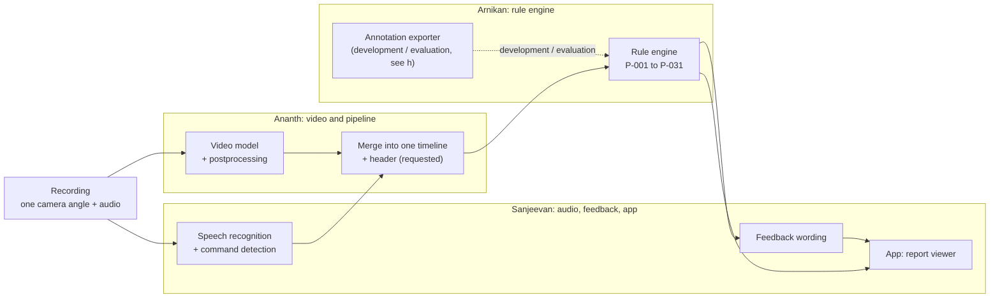

## (b) Inside the rule engine

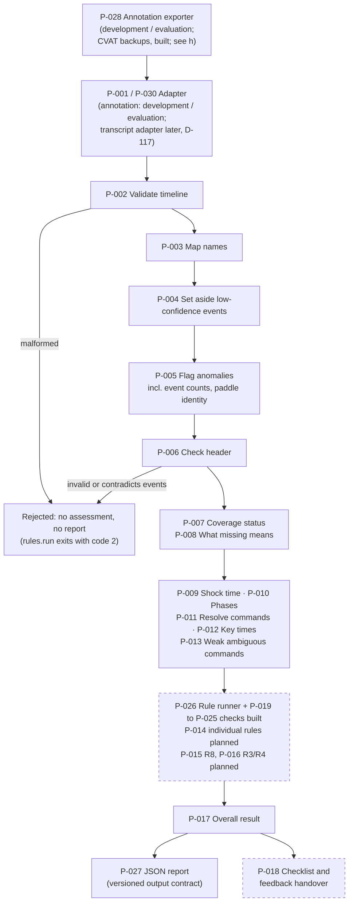

## (c) The decision ladder every rule follows (P-026, P-014)

The rule runner (P-026, Increment 7) and the shared checks (P-019 to P-025, Increment 6) are
**built**; the individual rules that use them come in Increments 11 to 23. Times on the ladder are
compared with P-025, and time limits with P-024 (timing not checked when there is no limit).

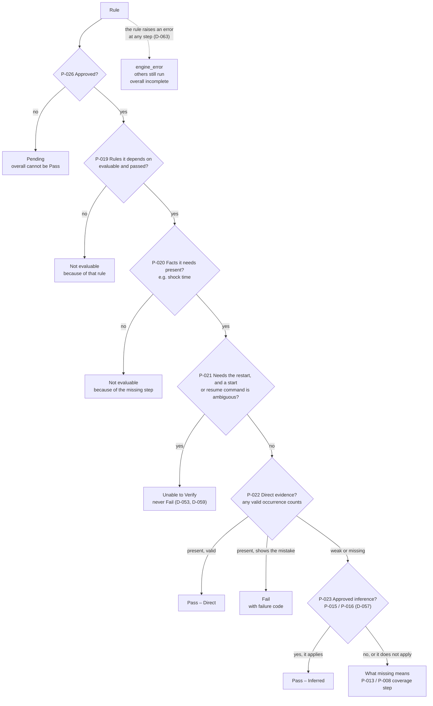

## (d) What a missing event means (P-007, P-008, P-013)

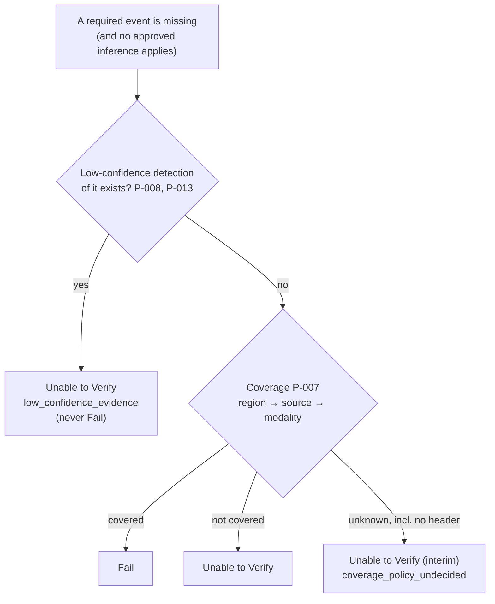

## (e) Shock time, phases and command resolution (P-009, P-010, P-011; D-093)

The shock time comes only from the screen. It is never inferred, from the paddle removal or
anything else, and there is no fallback setting (D-093, D-115).

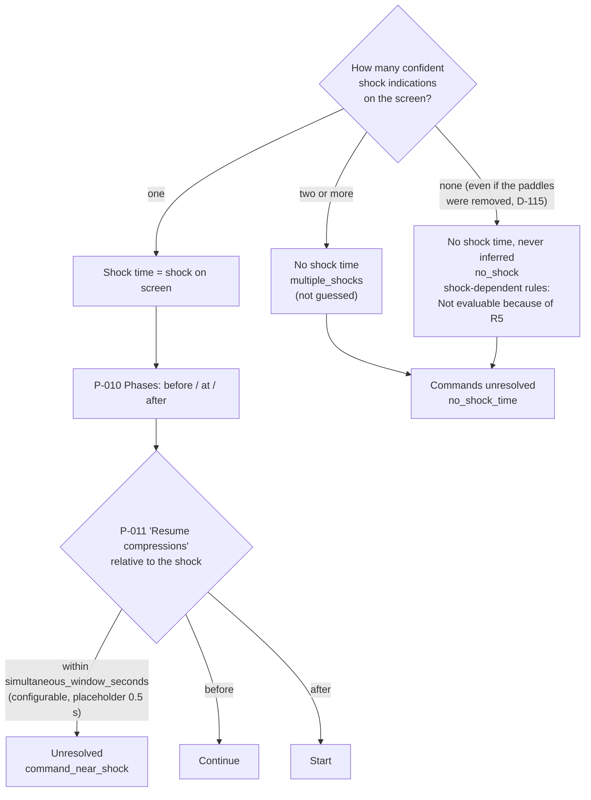

### (e2) Which start command is the restart (P-012)

Every start command goes through these checks **on its own**. Commands that do not count are
set aside, and the **earliest remaining** one is the restart, so a later start can still be
the restart. The shock time is either from the screen or absent (D-093, D-115).

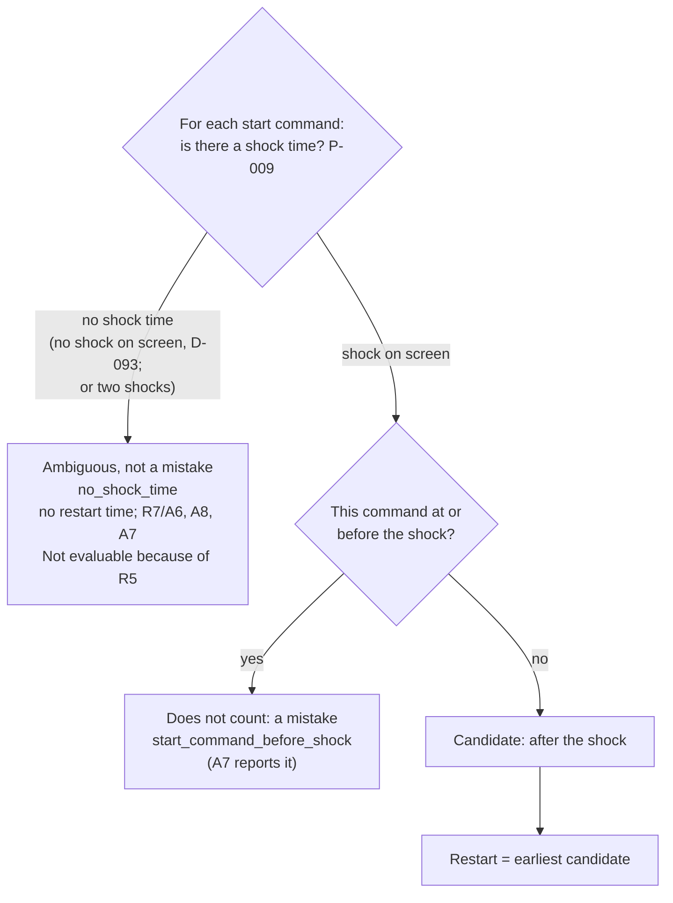

## (f) R8: apical before sternal (P-015, built in Increment 12; pending until approved)

Zones count as visible when covered over the placement phase, from the first paddle taken to
paddles firmly on chest (D-092, D-099). Derived placements reach R8 only past the gate (D-088).
A parallel placement fails R2 as well, separately, with the same cause flag (D-098). With only
one zone in view the order can't be established: there is no one-zone inference (D-116).

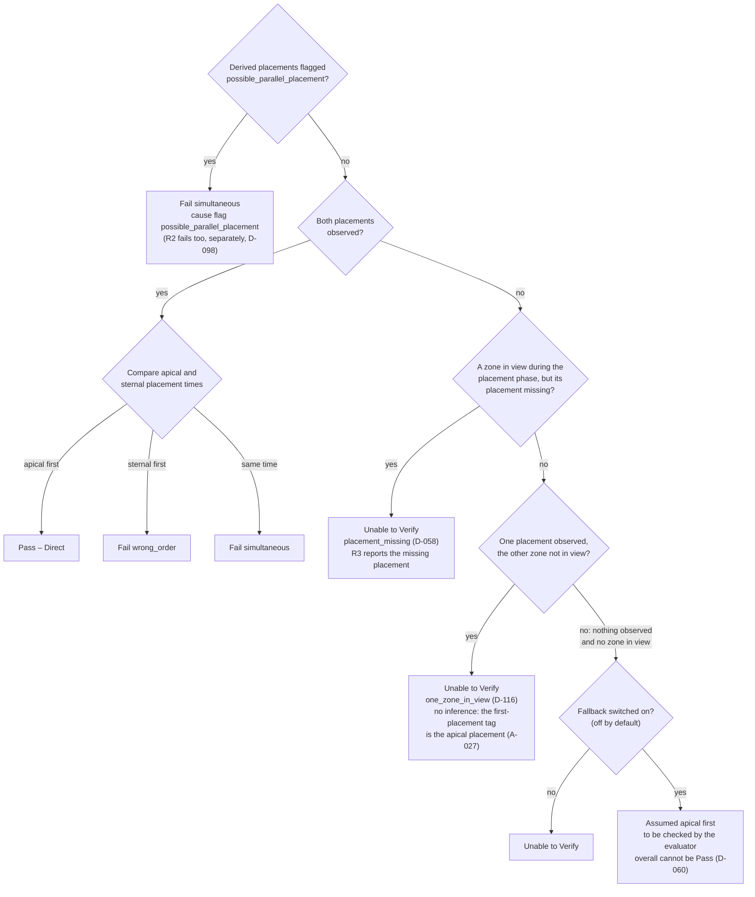

## (g) Overall result (P-017, built)

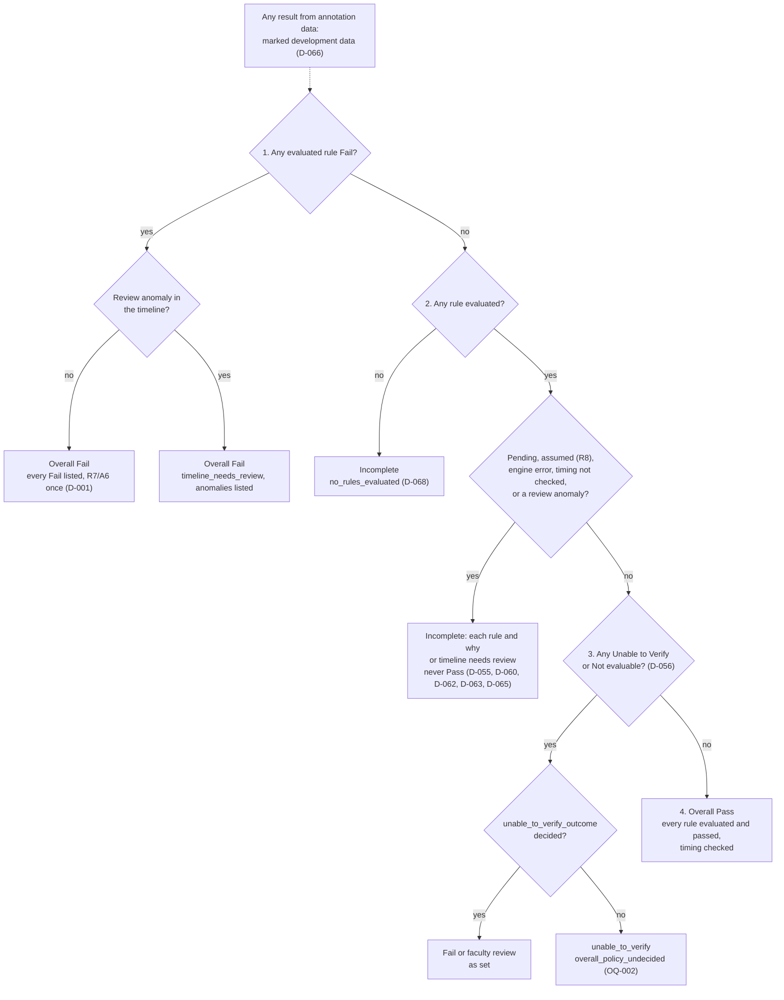

## (h) How annotation data reaches the rule engine (P-028, P-029, P-001; D-074, D-083)

**Ananth runs** the rule engine's exporter and audit on the final CVAT backups, which are with him
(D-083), and sends Arnikan only the records, the export manifest and the audit outputs, never
media (D-085). The training pipeline is untouched: none of its scripts or files change, and it
never reads the exporter's output. Until the final export arrives, Increment 10 uses the
smoke-run export of 39 corrected backups (D-084). This whole path is for development and
evaluation, not the runtime input: in production the engine will read the pipeline's procedure
transcript (D-117).

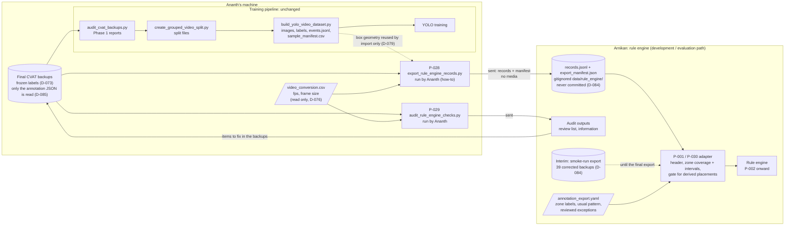

## (i) How a zone's coverage is decided for a recording (P-030, P-007; D-074, D-080, D-082, D-092, D-094)

Decided per zone (apical, sternal) for one annotated recording by the adapter (built, Increment
10). The defibrillator screen (region `screen`, R5) and each paddle (regions `apical_paddle`,
`sternal_paddle`, R4, D-108) go through the same steps, without reviewed exceptions (D-094). When a rule asks about a time window, P-007 uses the zone's visible intervals (D-092). The
view's usual zone pattern is used only by the audit's review list, never here.

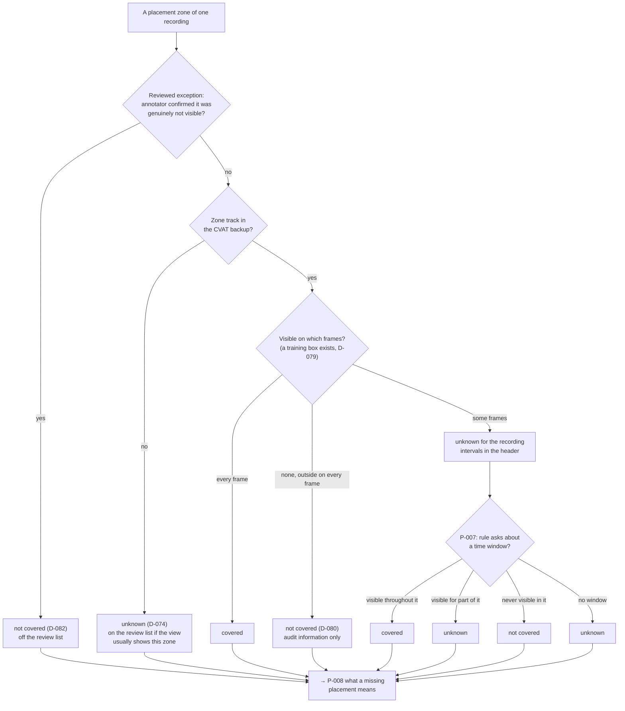

## (j) Derived per-paddle placement (P-031, Step 9c; D-081, D-086 to D-088, D-090, D-091)

Built in the exporter, per paddle **label** across all its tracks (D-087). T1 is
`first_paddle_firmly_on_the_chest` and T2 is `paddles_firmly_on_chest` (A-019). Settings are
placeholders.

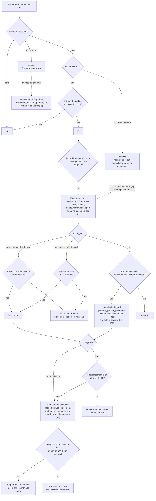

## (k) R6: paddles removed after the shock (P-034, built in Increment 14; pending until approved)

`paddles_removed_after_shock` means the paddles were removed; it doesn't prove a shock (D-104).
The tolerance `w` is `removal_before_screen_tolerance_seconds` (the screen may show the shock after
the discharge, D-105).

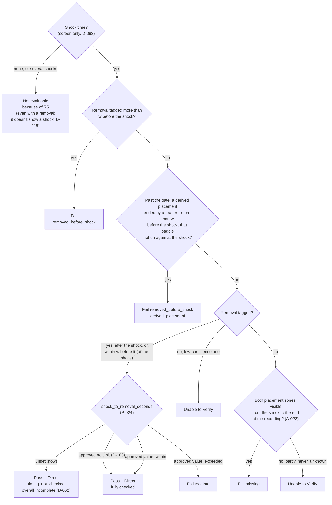

## (l) R3: paddles placed firmly on the chest (P-035, built in Increment 15; pending until approved)

Placement timing and presence only; `not_in_zone` waits for the approved chest regions (OQ-012,
D-106). `w` is `simultaneous_window_seconds`. The only inference source is the shock on the
screen; a paddle removal never infers (D-115).

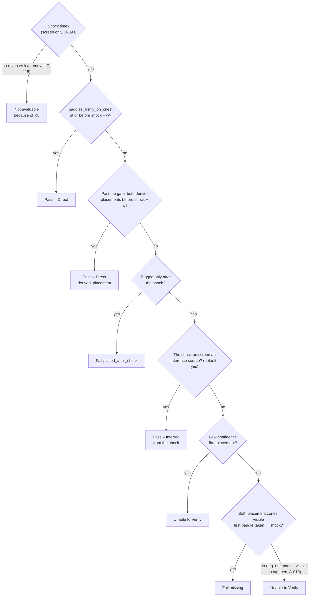

## (m) R4: both discharge buttons pressed (P-036, built in Increment 16; pending until approved)

The placement is the firm-placement tag, or past the gate the later derived placement. `w` is
`simultaneous_window_seconds`. The only inference source is the shock on the screen, so the
coverage branch is unreachable by default (OQ-061); a paddle removal never infers (D-115).

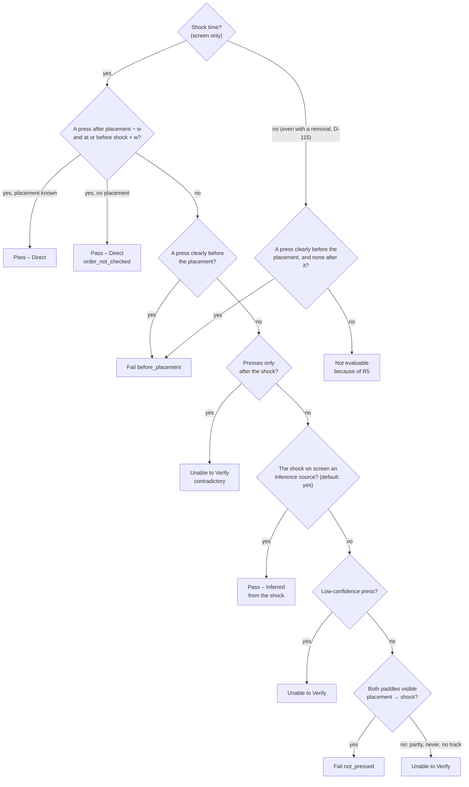

## (n) Step 9d: derived per-zone gel application (P-037; D-111, D-112)

Built in the rule engine's exporter from the `learner_hand` box (the bottle hand only, A-024) and
the zone boxes. Settings are placeholders.

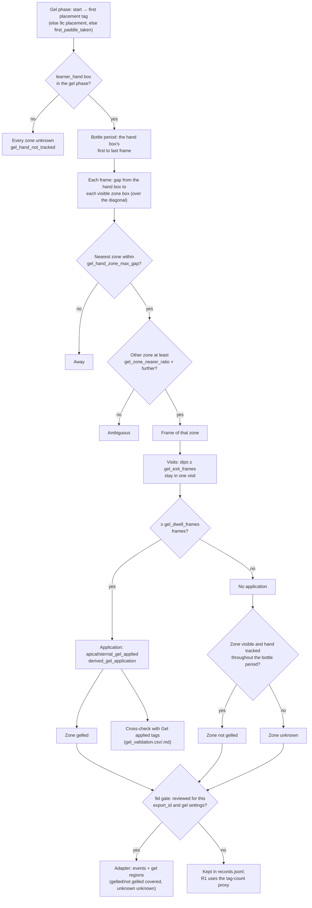

## (o) R1: gel twice, once to each zone, before placement (P-038, built in Increment 17; pending until approved)

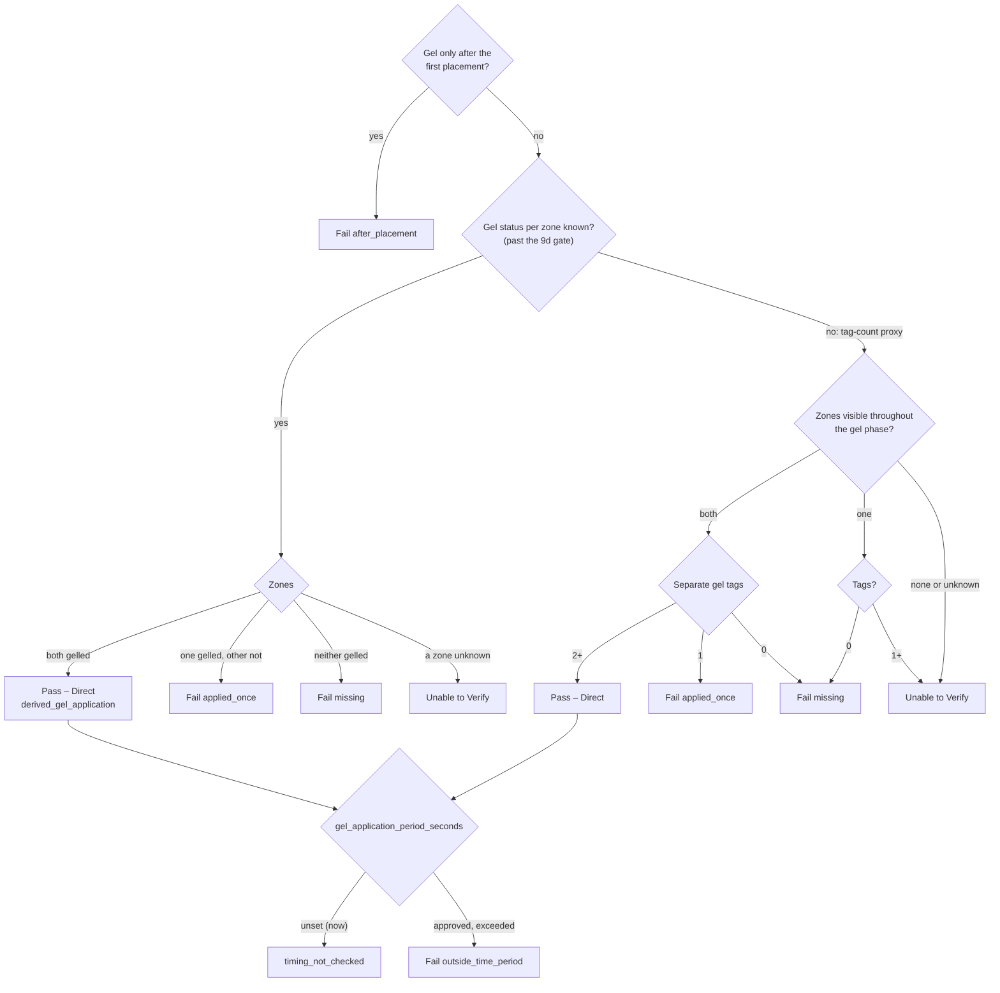
