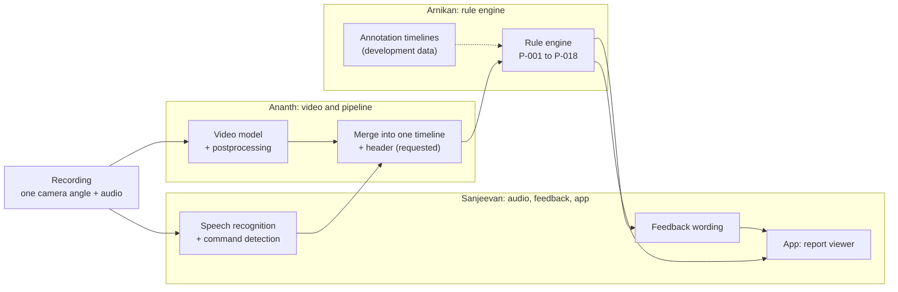
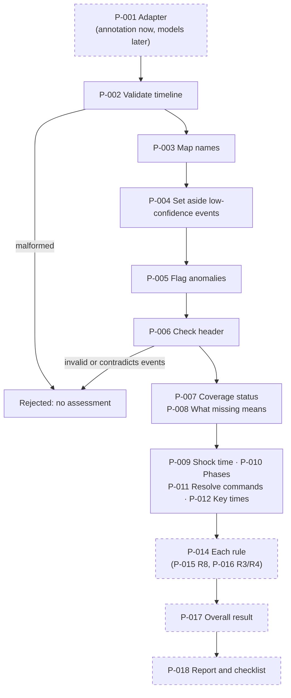
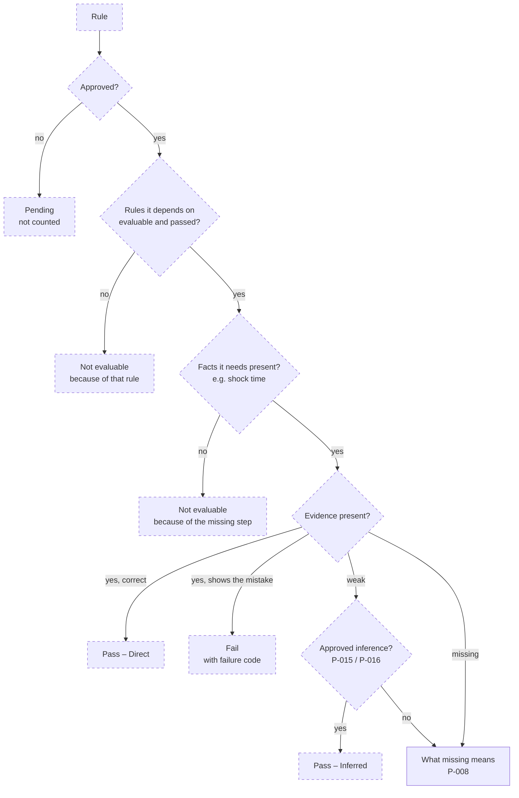
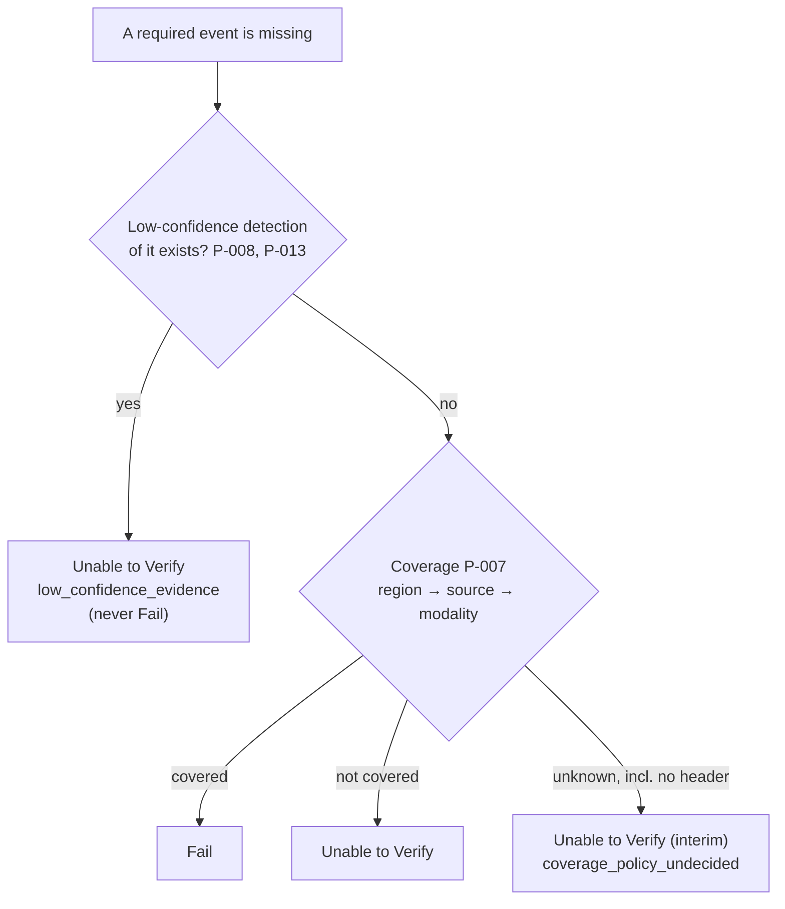
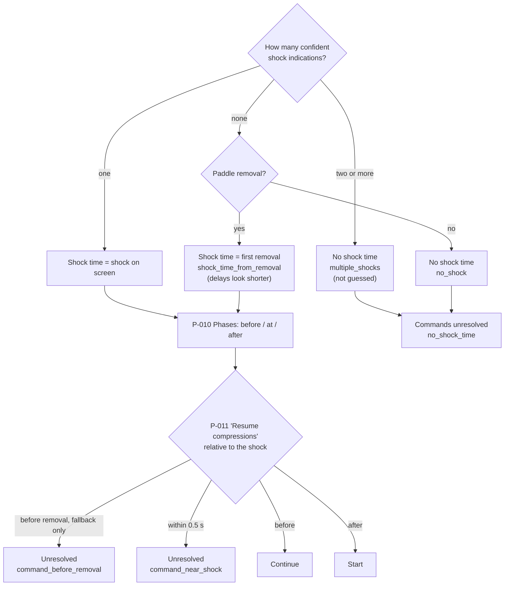
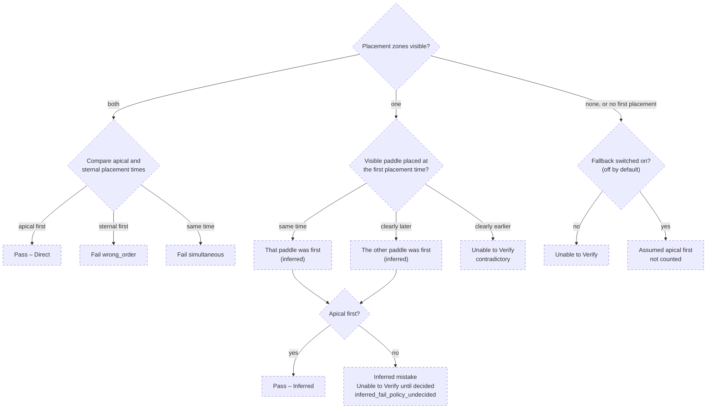
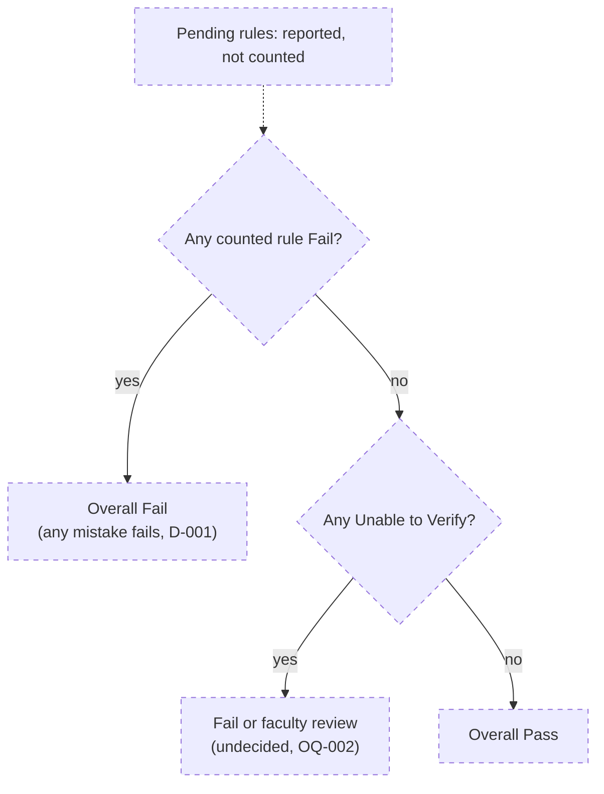

# Rule engine: diagrams

Mermaid diagrams (they render on GitHub). They follow [decision_flow.yaml](decision_flow.yaml),
and boxes are labelled with its decision-point IDs (P-xxx). **Dashed boxes are planned**, not
built yet. Detailed conditions are in [pathways.md](pathways.md).

## (a) End to end: from recording to report

## (b) Inside the rule engine

## (c) The decision ladder every rule follows (P-014, planned)

## (d) What a missing event means (P-007, P-008, P-013)

## (e) Shock time and phases (P-009, P-010, P-011)

## (f) R8: apical before sternal (P-015, planned)

## (g) Overall result (P-017, planned)

