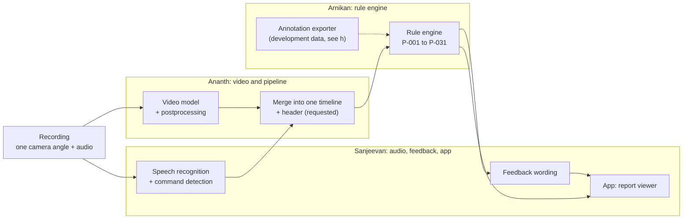
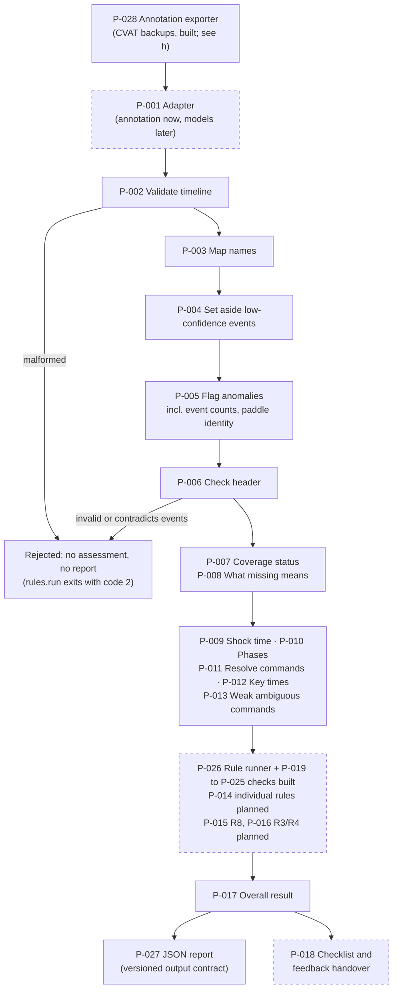
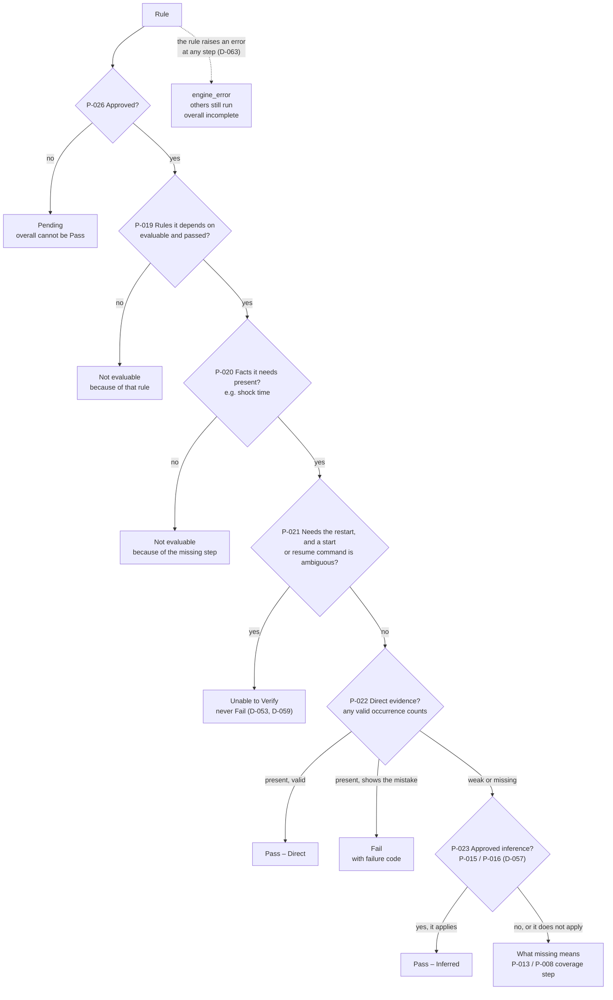
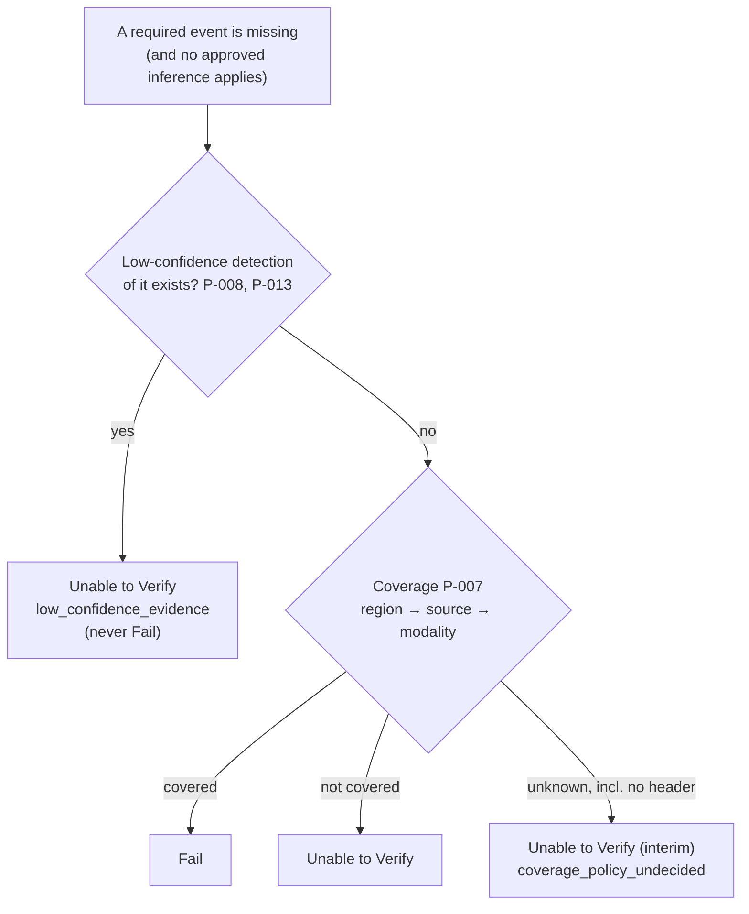
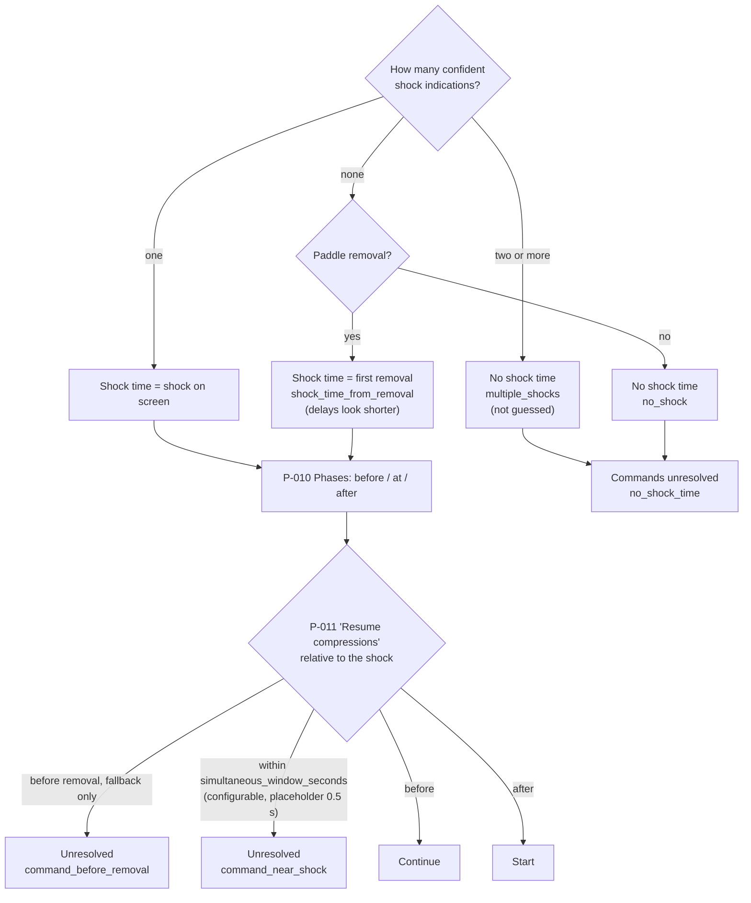
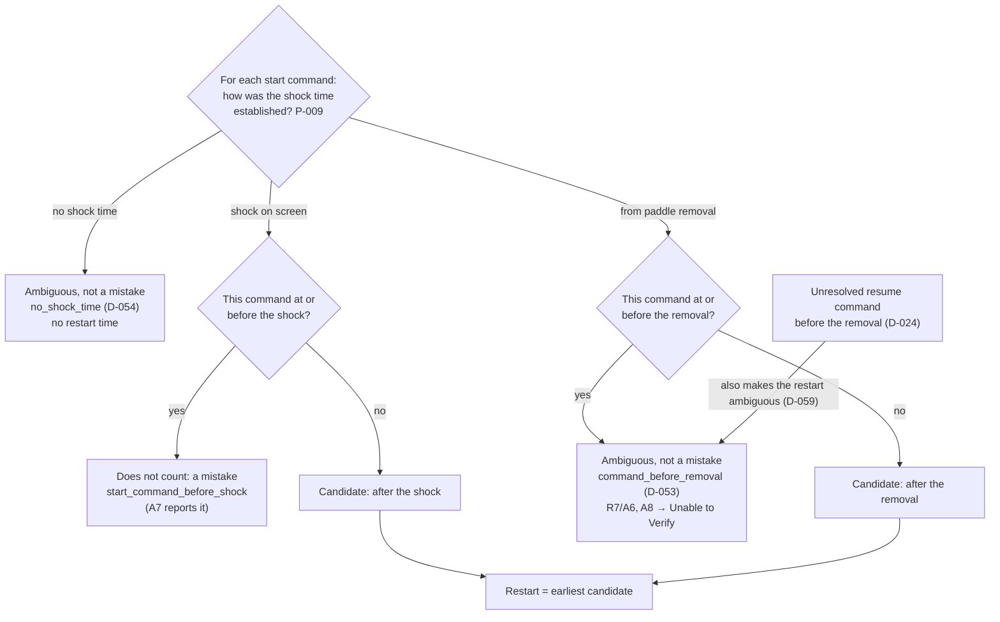
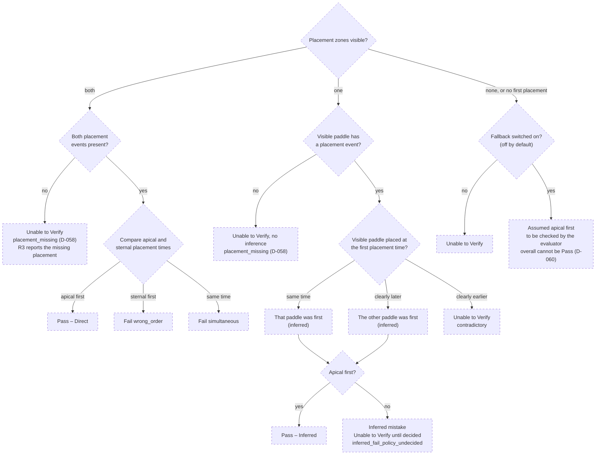
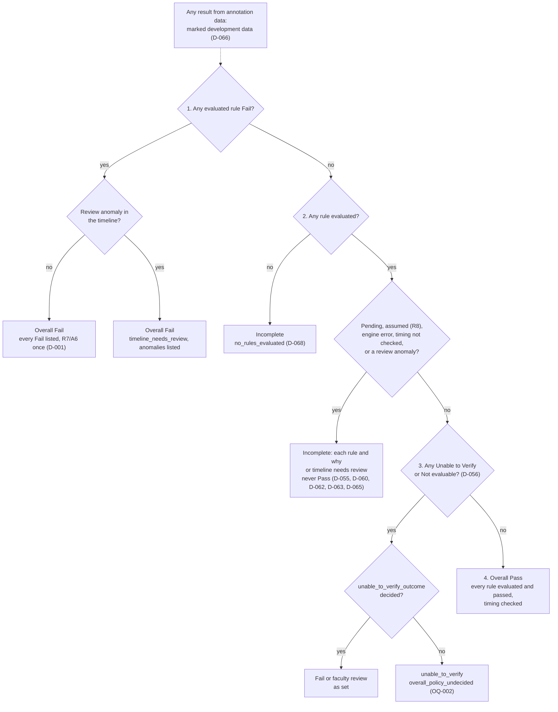
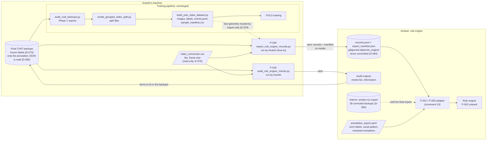
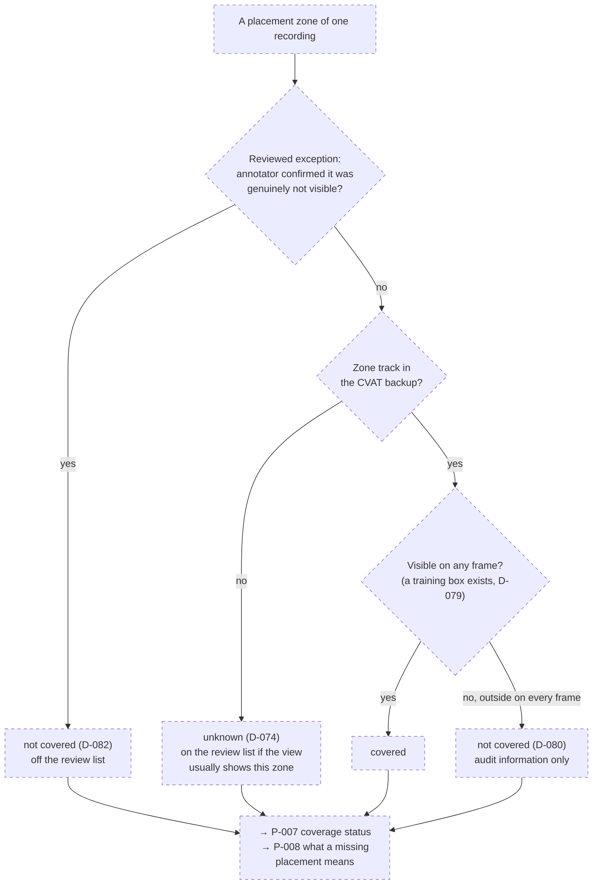

# Rule engine: diagrams

Mermaid diagrams (they render on GitHub). They follow [decision_flow.yaml](decision_flow.yaml),
and boxes are labelled with its decision-point IDs (P-xxx). **Dashed boxes are planned**, not
built yet. Detailed conditions are in [pathways.md](pathways.md).

## (a) End to end: from recording to report

## (b) Inside the rule engine

## (c) The decision ladder every rule follows (P-026, P-014)

The rule runner (P-026, Increment 7) and the shared checks (P-019 to P-025, Increment 6) are
**built**; the individual rules that use them come in Increments 11 to 23. Times on the ladder are
compared with P-025, and time limits with P-024 (timing not checked when there is no limit).

## (d) What a missing event means (P-007, P-008, P-013)

## (e) Shock time, phases and command resolution (P-009, P-010, P-011)

### (e2) Which start command is the restart (P-012)

Every start command goes through these checks **on its own**. Commands that do not count are
set aside, and the **earliest remaining** one is the restart, so a later start can still be
the restart.

## (f) R8: apical before sternal (P-015, planned)

## (g) Overall result (P-017, built)

## (h) How annotation data reaches the rule engine (P-028, P-029, P-001; D-074, D-083)

**Ananth runs** the rule engine's exporter and audit on the final CVAT backups, which are with him
(D-083), and sends Arnikan only the records, the export manifest and the audit outputs, never
media (D-085). The training pipeline is untouched: none of its scripts or files change, and it
never reads the exporter's output. Until the final export arrives, Increment 10 uses the
smoke-run export of 39 corrected backups (D-084).

## (i) How a zone's coverage is decided for a recording (P-030; D-074, D-080, D-082)

Decided per zone (apical, sternal) for one annotated recording, in Increment 10. The view's usual
zone pattern is used only by the audit's review list, never here.

