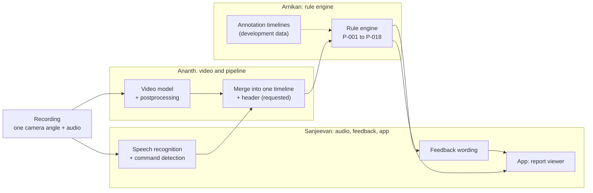
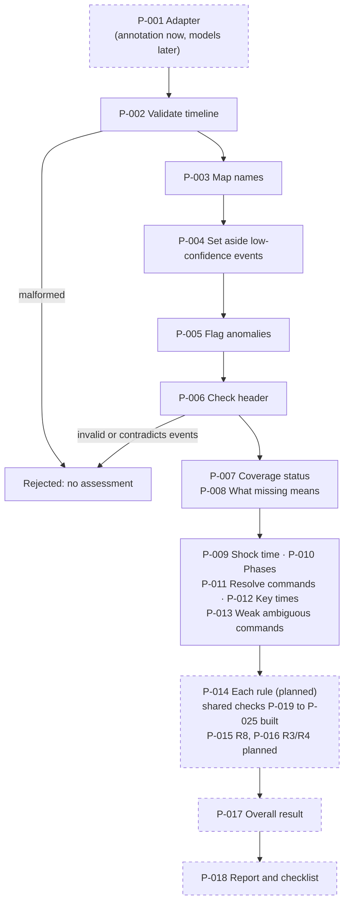
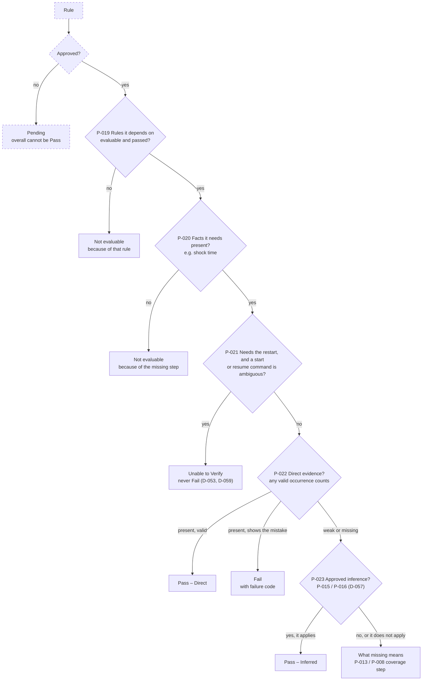
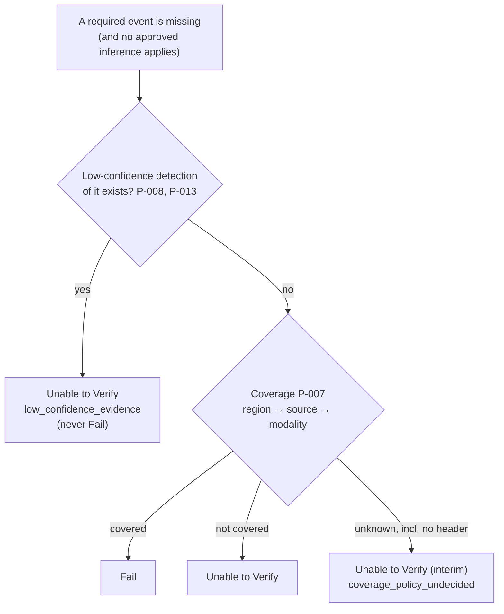
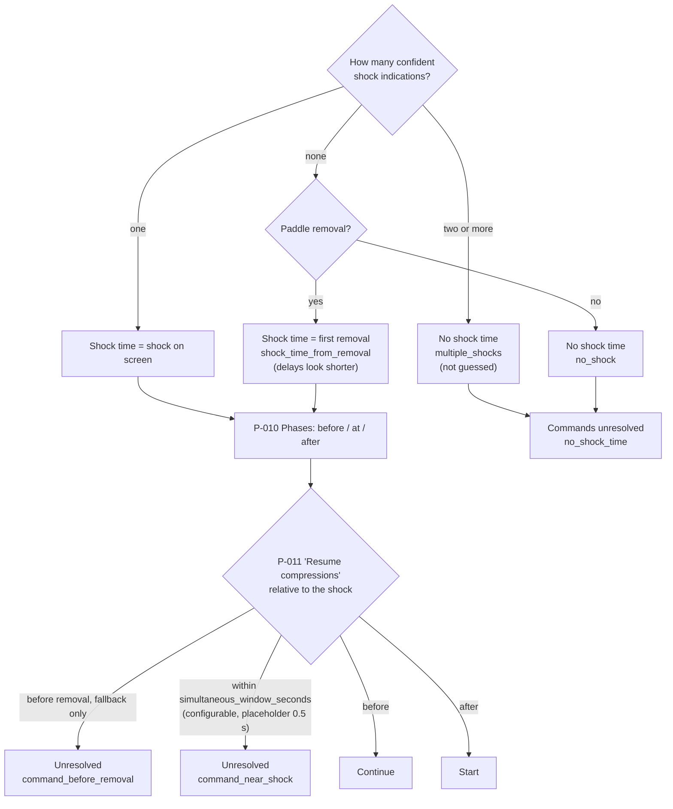
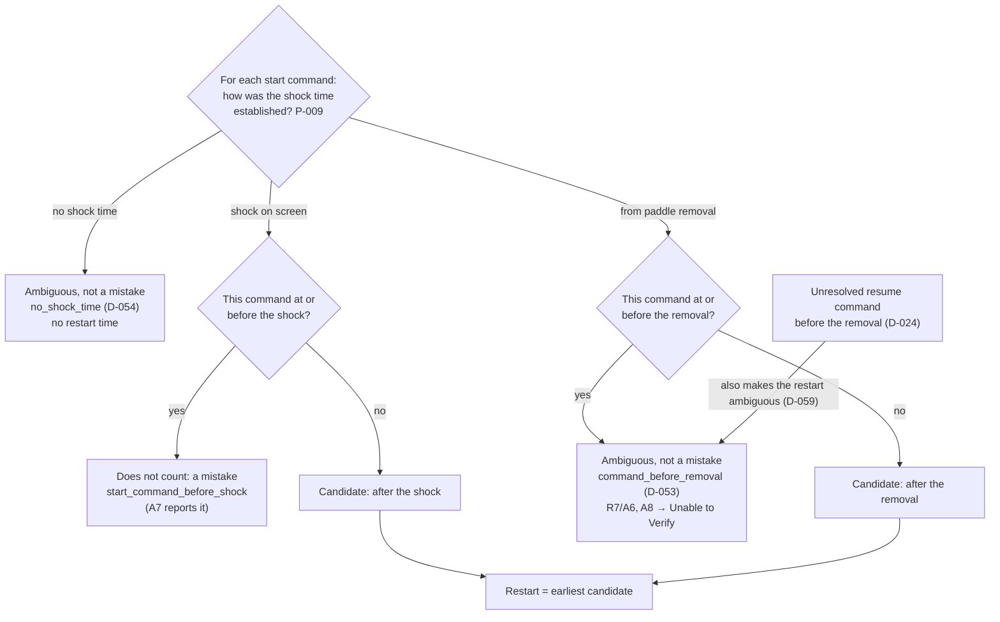
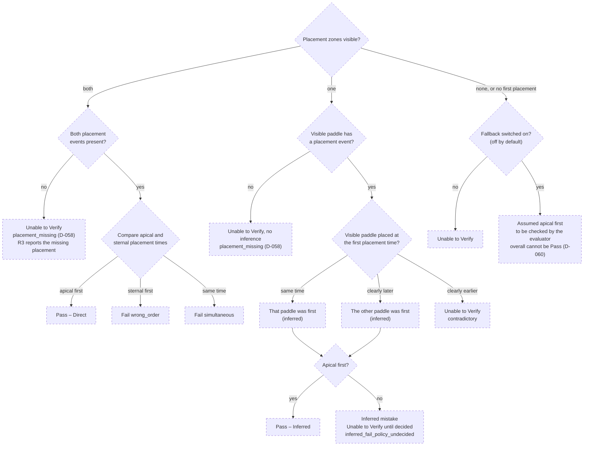
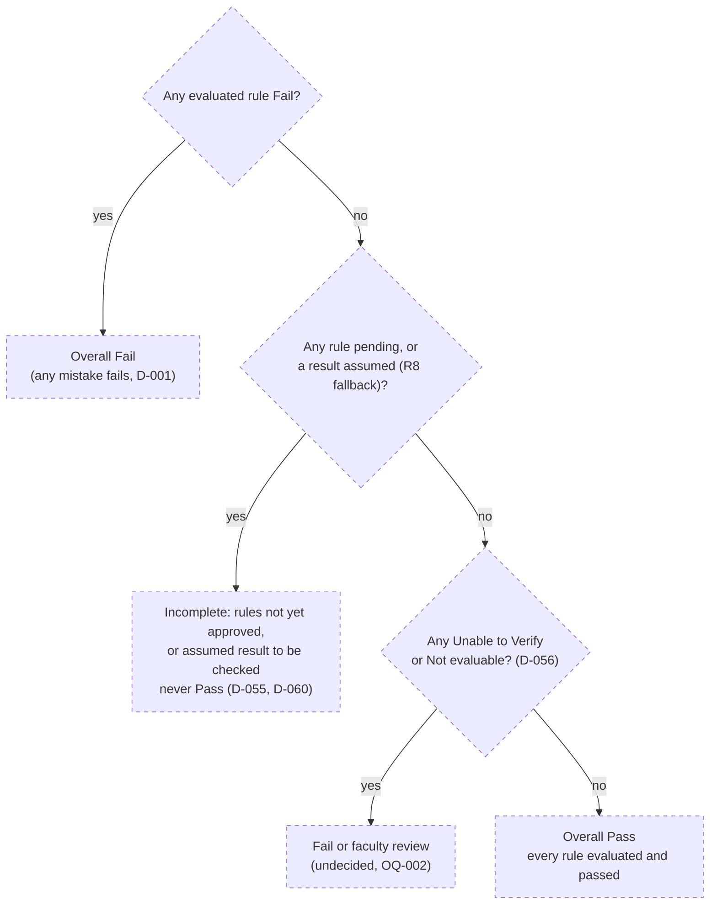

# Rule engine: diagrams

Mermaid diagrams (they render on GitHub). They follow [decision_flow.yaml](decision_flow.yaml),
and boxes are labelled with its decision-point IDs (P-xxx). **Dashed boxes are planned**, not
built yet. Detailed conditions are in [pathways.md](pathways.md).

## (a) End to end: from recording to report

## (b) Inside the rule engine

## (c) The decision ladder every rule follows (P-014)

The shared checks (P-019 to P-025) are **built** (Increment 6). The engine that runs the ladder
for each rule, including the approval check, is planned for Increment 7. Times on the ladder are
compared with P-025, and time limits with P-024 (timing not checked when there is no limit).

## (d) What a missing event means (P-007, P-008, P-013)

## (e) Shock time, phases and command resolution (P-009, P-010, P-011)

### (e2) Which start command is the restart (P-012)

Every start command goes through these checks **on its own**. Commands that do not count are
set aside, and the **earliest remaining** one is the restart, so a later start can still be
the restart.

## (f) R8: apical before sternal (P-015, planned)

## (g) Overall result (P-017, planned)

