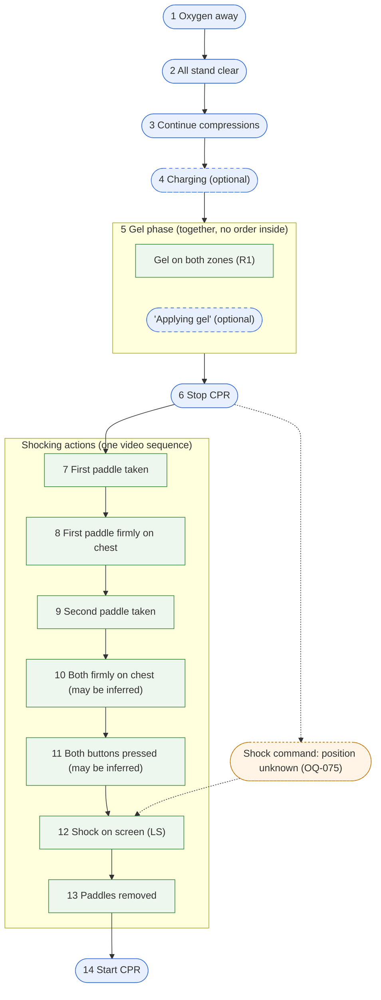

# The defibrillation procedure we assess

The single reference for the order of steps the rule engine follows. The machine-readable source is
[configs/rule_engine/procedure_order.yaml](../../configs/rule_engine/procedure_order.yaml); a test
(`tests/test_rule_engine_docs.py`, ProcedureDocMatchesOrder) fails if the steps or their order here
differ from it.

## Source and status
- **Source:** the lecturer's ground-truth video, reported by Arnikan on 2026-11-24 (D-127). The
  original ARTS proposal is the source for the parts the video doesn't settle: the shock command (A5)
  before the shock, and each rule's definition.
- **Status:** **NOT clinically approved.** `approved_by` is null until the medical supervisor confirms
  the order (OQ-062).
- **How the order is checked:** each "X before Y" relation has one owner (D-123). The rule that
  already checks it owns it; A7 owns the other audio pairs; S1 "Procedure order" (built in Increment
  27, pending) judges the relations no other rule owns, derived per recording from the observed steps,
  so a relation across a missing or unseen step is still judged once (D-126, OQ-078). Steps marked optional are checked for their position
  only when present.

## Steps
"Step" is the ID used in `procedure_order.yaml`. Evidence: audio (Sanjeevan's command events, D-125),
video (the camera), or both. "Best angle" refers to the camera views in
[camera_angle_evidence.md](camera_angle_evidence.md); audio steps come from the audio track in any
view. Steps sharing a number happen together (an interchangeable group): neither is checked against
the other.

| # | Step | What | Evidence | Canonical event(s) | Rule | Compulsory | Best angle | Can be inferred | Open questions |
|---|---|---|---|---|---|---|---|---|---|
| 1 | `A1` | Oxygen away | audio | `oxygen_away_command` | A1 | compulsory | — | no | OQ-077 |
| 2 | `A3` | All stand clear | audio | `stand_clear_command` | A3 | compulsory | — | no | OQ-077 |
| 3 | `A2` | Continue compressions | audio | `continue_compressions_command` (or a resolved resume command) | A2 | compulsory | — | no | OQ-077 |
| 4 | `CHARGE` | Charging | audio | `charging_command` | none (position by A7 and S1) | optional | — | no | OQ-072, OQ-074 |
| 5 | `R1` | Gel phase: gel on both placement zones | video | `gel_applied`, `apical_gel_applied`, `sternal_gel_applied` | R1 | compulsory | LS (both zones in view) | no | — |
| 5 | `GELCMD` | Gel phase: "applying gel", said during it | audio | `gel_announcement_command` | none (position by A7 and S1) | optional | — | no | OQ-073 |
| 6 | `A4` | Stop CPR | audio | `stop_compressions_command` | A4 | compulsory | — | no | OQ-076 |
| 7 | `R2A` | First paddle taken (by time, D-118) | video | `first_paddle_taken`, `second_paddle_taken` | R2 | compulsory | LS | no | — |
| 8 | `PLACE` | First paddle firmly on the chest | video | `first_paddle_placed`, `apical_paddle_placed`, `sternal_paddle_placed` | R2, R8 | compulsory | LS (both zones in view) | no | — |
| 9 | `R2B` | Second paddle taken | video | `first_paddle_taken`, `second_paddle_taken` | R2 | compulsory | LS | no | — |
| 10 | `R3` | Both paddles firmly on the chest | video | `paddles_firmly_on_chest` | R3 | compulsory | LS | yes, from the shock on screen (D-102) | OQ-061 |
| 11 | `R4` | Both buttons pressed | video | `both_paddle_buttons_pressed` | R4 | compulsory | LS, T | yes, from the shock on screen (D-102) | OQ-061 |
| 12 | `R5` | Shock delivered on the screen | video | `shock_delivered_on_screen` | R5 | compulsory | LS (T partly) | no | — |
| 13 | `R6` | Paddles removed after the shock | video | `paddles_removed_after_shock` | R6 | compulsory | LS | no | — |
| 14 | `R7` | Start CPR | audio | `start_compressions_command` (or a resolved resume command) | R7/A6 | compulsory | — | no | OQ-076 |

Steps 7 to 13 are the shocking actions, one video sequence (confirmed by Arnikan, 2026-11-24). The
paddle steps come from the paddle order, by time, never from the tag names (A-027, D-118).

## Position unknown
| Step | What | Evidence | Canonical event(s) | Rule | Known relations | Open questions |
|---|---|---|---|---|---|---|
| `A5` | Shock command | audio | `shock_command` | A5 | after stop (A4 → A5, A7) and before the shock (A5 → R5, A5's own rule), as in the proposal; its place among the shocking actions (`R2A`, `PLACE`, `R2B`, `R3`, `R4`) is unknown and unchecked | OQ-075 |

## How the whole engine judges this procedure
Every step is judged by its own rule (the "Rule" column), video and audio in one timeline. Each "X
before Y" relation has exactly one owner, so one mistake is reported once (D-123):

| Relation | Judged by |
|---|---|
| R1 → PLACE (gel before the paddles) | R1 |
| R2A → PLACE → R2B (the paddle taken first placed before the other is taken) | R2 |
| R3 → R5; R3 → R4 → R5 | R3; R4 |
| R5 → R6 (removed after the shock) | R6 |
| A1, A2, A3, A5 → R5 (said before the shock) | A1, A2, A3, A5 |
| A2 → A4 (continue before stop); A4 → R5 | A4 |
| R5 → R7 (restart after the shock) | R7/A6 |
| Every other pair of audio commands | A7 (the command order) |
| Everything else | S1 (the procedure order) |

**S1, per recording (D-126, D-131):** S1 takes the observed steps, keeps the order between neighbouring
observed steps, and drops every relation another rule owns. With every step observed, as in the
lecturer's video, that leaves charging → gel phase, gel phase → stop, stop → first paddle taken, second
paddle taken → both firmly on the chest, and removal → start. When a step is missing or unseen, the
relation that bridges it is still judged once. A step S1 finds out of place that another rule already
reports (for example gel after the placement, R1's) is left to that rule.

**Evidence policies** ([supervisor_briefing.md](supervisor_briefing.md#the-design-policies)):
- a step "in the wrong place" fails only if the right place was clearly observed (D-128);
- a tag that contradicts the confirmed shock is Unable to Verify, "contradictory" (D-129);
- a Pass that rests on something not happening needs that window clearly observed (D-130, D-132);
- ties within the window (0.5 s in one modality, 1.0 s between audio and video) are not ordered, and
  any occurrence in the right place counts.

## Flowchart
Audio steps are rounded, video steps square. Optional steps are dashed. The gel phase is one box,
and inferable steps are marked.

## Open questions
Every open question for the supervisor, Sanjeevan and Ananth is in one list in
[supervisor_briefing.md, section 4](supervisor_briefing.md#4-every-open-question-in-one-list). Those
about the order:
- **OQ-062:** the supervisor's confirmation of the complete order (it is the lecturer's interim
  order until then).
- **OQ-063:** which steps, if any, may swap?
- **OQ-064:** is the procedure order (S1) its own checklist item?
- **OQ-072:** is the spoken "charging" compulsory? If yes, a presence rule (A9).
- **OQ-073:** is the spoken "applying gel" compulsory?
- **OQ-074:** does the `charging_sound` event count as evidence for charging?
- **OQ-075:** is the shock command (A5) required, and where does it go among the shocking actions?
- **OQ-076:** A8 pre-shock pause: stop to start (approved, 5 s), or stop to the shock?
- **OQ-077:** must oxygen away, stand clear and continue be in exactly this order?

## When the order changes
Change `procedure_order.yaml` (see [audio_integration_plan.md](audio_integration_plan.md) section 11)
and this document together; the docs test fails until they match.
