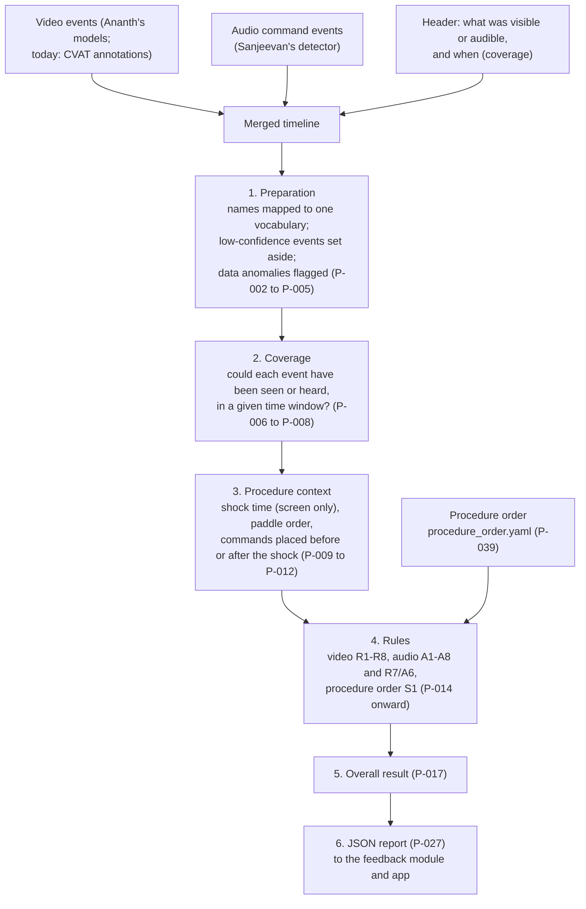
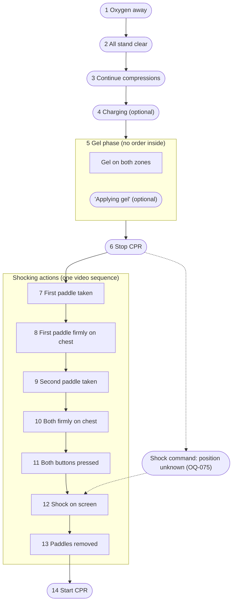

# The ARTS rule engine: work report

**For:** Ananth, Sanjeevan and the lecturers · **From:** Arnikan · **Date:** 2026-11-24 ·
**Branch:** `feature/audio-rules` (the video rules were merged to `main` on 2026-10-20, PR #7)

IDs in brackets point to the project registers: decisions (D-), open questions (OQ-), assumptions (A-),
decision points (P-) and worked examples (W-). The index of every document is [README.md](README.md).

## Contents
1. Purpose and scope
2. How it works
3. The procedure we follow
4. The rules
5. Result types and the overall result
6. Design policies
7. Key decisions and why
8. Development and evaluation path
9. Testing
10. What we need from each teammate
11. Open questions
12. Limitations and next steps
13. Timeline of the work
14. AI assistance statement

---

## 1. Purpose and scope

ARTS records a learner performing defibrillation on a training mannequin and gives feedback on the
procedure. The **rule engine** is the part that decides, for each step of the procedure, whether it
was done correctly, and then gives one overall result with its reasons.

**What it does**
- It reads one **timeline**: the events detected in the recording (video and audio) and a **header**
  saying what could be observed, and when.
- It checks 17 rules: 7 video rules, 9 audio rules (R7 and A6 are one check under two IDs) and one
  rule for the order of the whole procedure.
- It writes a **JSON report** for the feedback module and the app: one result per rule, the overall
  result and why (the output contract, [output_contract.md](output_contract.md), version 16).

**What it does not do**
- It never looks at video frames or audio. Detecting events is the job of the video models (Ananth)
  and the audio command detection (Sanjeevan).
- It doesn't decide clinical values or the procedure. Time limits, the order of steps and the
  accepted phrases come from the medical supervisor; until then they are empty or marked provisional.
- It doesn't write the evaluator checklist yet (planned, OQ-036).

**My role.** I am the annotation lead (the CVAT annotations of the team's recordings and their
export for the rule engine) and the rule engine lead: its design, its decisions, the rules and their
review. The code was written with an AI coding agent under my direction (section 14).

## 2. How it works

The engine runs the same stages for every recording.

- **Input: a merged timeline.** Each event has a name, a start and end time, a source (video, audio or
  annotation) and a confidence. Video events are points in time; an audio command carries the whole
  Whisper segment it was heard in (from its start to its end), because the detector gives no word
  times yet (D-125). The **header** gives the recording's length, which analyses ran, and the
  **visibility intervals**: when each camera region (a placement zone, a paddle, the screen) was in
  view, and when the audio was clear.
- **Preparation** maps every label to one canonical name (the vocabulary), sets aside events below
  their confidence threshold (they are logged, never used as evidence), and flags data problems such
  as two shocks. Malformed input is rejected and no report is produced.
- **Coverage** answers one question for every rule: *could this event have been seen or heard in this
  time window?* Visible throughout → covered; part of it → unknown; never → not covered (D-092). A
  missing event fails only when it was covered (D-007).
- **Procedure context** computes the shared facts once, so every rule uses the same values: the
  shock time (only from the shock shown on the screen, D-093), the order in which the paddles were
  taken and placed (from the event times, D-118), and whether an ambiguous "continue/resume" command
  came before the shock (continue) or after it (restart) (P-011, D-125).
- **Rules** are small functions, one per rule, built from shared checks. Every rule is always
  evaluated (D-002).
- **Overall result** (section 5) and the **report** (`python -m rules.run`). The pipeline currently
  shows the individual rule results; calling the full assessment from the pipeline is OQ-017.

## 3. The procedure we follow

The order comes from the **lecturer's ground-truth video**, reported on 2026-11-24 (D-127). It is the
interim order, **not clinically approved** until the medical supervisor confirms it (OQ-062). The
full table, with each step's evidence, rule and status, is in [procedure.md](procedure.md).

Rounded boxes are spoken commands (audio); square boxes are actions seen on video. Each "X before Y"
relation is judged by exactly one rule: the step's own rule where it already checks it (for example
R6 owns "removed after the shock"), A7 for the other pairs of commands, and S1 for the rest (D-123,
D-126). The open questions about the procedure (A5, "charging", "applying gel", A8's definition, the
opening order) are in procedure.md with what the engine does meanwhile.

## 4. The rules

All 17 rules are **built and tested**. All are **pending** in `configs/rules.yaml`: none counts in a
real assessment until the supervisor approves its definition (D-043). The demo runs them with a
demo-only configuration (D-114), where A5, A8 and S1 are **held back** because an open question would
otherwise fail a correct learner.

| Rule | What it checks | Fails with | Status | Open questions |
|---|---|---|---|---|
| R1 Gel applied twice | Gel once on each placement zone, either order, before the first paddle is placed (P-038) | `after_placement`, `applied_once`, `missing`, `outside_time_period` | built, pending | OQ-016, OQ-021 |
| R2 Second paddle after the first is placed | The paddle taken first is placed before the other is taken (P-032) | `taken_before_first_placed`, `simultaneous`, `first_placement_not_observed` | built, pending | OQ-022, OQ-059 |
| R8 Apical before sternal | The apical paddle placed before the sternal, both placements seen (P-015) | `wrong_order`, `simultaneous` | built, pending | OQ-004, OQ-006, OQ-059 |
| R3 Paddles firmly on the chest | Firmly placed before the shock, or inferred from the shock on the screen (P-035) | `placed_after_shock`, `missing` | built, pending | OQ-012, OQ-061 |
| R4 Both buttons pressed | After the placement and before the shock, or inferred from the shock (P-036) | `before_placement`, `not_pressed` | built, pending | OQ-023, OQ-061 |
| R5 Shock on the screen | One new shock indication (P-033) | `missing` | built, pending | OQ-057 |
| R6 Paddles removed after the shock | The removal after the shock on the screen (P-034) | `removed_before_shock`, `missing`, `too_late` | built, pending | OQ-016 |
| A1 Oxygen away | Said before the shock (P-040) | `after_shock`, `missing` | built, pending | OQ-010, OQ-016, OQ-077 |
| A2 Continue compressions | Said in the preparation, before the shock (P-041) | `wrong_stage`, `missing` | built, pending | OQ-009, OQ-077 |
| A3 All stand clear | Said before the shock (P-040) | `after_shock`, `missing` | built, pending | OQ-010, OQ-016, OQ-077 |
| A4 Stop compressions | After "continue", before the shock (P-041) | `wrong_order`, `after_shock`, `missing` | built, pending | OQ-009, OQ-016 |
| A5 Shock command | Before or at the shock (P-042) | `after_shock`, `missing` | built, pending, held back | OQ-075, OQ-009 |
| R7/A6 Restart compressions | Start said after the shock; one check, two IDs (P-043, D-044) | `before_shock`, `missing`, `too_late` | built, pending | OQ-009, OQ-016 |
| A7 Command order | The commands heard in the expected order, on its audio relations (P-045) | `wrong_order` | built, pending | OQ-062, OQ-077 |
| A8 Pre-shock pause | Stop to restart within 5 s (approved, D-016); the end event is a setting (P-044) | `pre_shock_pause` | built, pending, held back | OQ-076, OQ-009 |
| S1 Procedure order | The whole procedure in order, on the relations no other rule judges (P-046) | `wrong_order` | built, pending, held back | OQ-062, OQ-064 |

Two codes are not produced yet, by design: `too_late` (R6, R7/A6) and `outside_time_period` (R1) need
a time limit, and every such limit is still unset (OQ-016). R3's `not_in_zone` waits for the chest
regions (OQ-012).

## 5. Result types and the overall result

**Each rule gives one result:**

| Result | Meaning | Example |
|---|---|---|
| **Pass – Direct** | The step was seen done correctly | Gel seen on both zones before the paddles |
| **Pass – Inferred** | Not seen, but shown by an approved inference | The shock on the screen shows the buttons were pressed (D-102) |
| **Fail** | The evidence clearly shows the mistake, named by a failure code | `removed_before_shock` |
| **Unable to Verify** | The evidence can't settle it: out of view, unclear audio, low confidence, or contradictory | The screen not in view when the shock was due |
| **Not evaluable because of X** | It depends on something missing that rule X reports; the parts that can still be judged are checked (D-119, D-121) | No shock on the screen → R6 "not evaluable because of R5" |
| **Pending** | The rule is not yet approved by the supervisor | Every rule in the real configuration today |

Results also carry **flags** that explain them: for example `timing_not_checked` (no limit given
yet), `order_partially_checked` (part of an order couldn't be checked), `correct_occurrence_unseen`
(a Fail withheld because the right place wasn't observed, D-128).

**The overall result** (P-017), in this order:
1. **Any Fail → Fail**, listing every mistake (D-001). There are no severity levels.
2. Otherwise **Incomplete**, never Pass, if any rule is pending, assumed or in error, a time limit
   isn't set or approved, an order couldn't be (fully) checked, or the data needs review (D-055,
   D-062, D-069, D-100).
3. Otherwise, if anything is Unable to Verify or Not evaluable: a setting the supervisor hasn't decided
   yet, Fail or "faculty review" (OQ-002). Until then it is reported as `unable_to_verify`.
4. Otherwise **Pass**: every step was actually checked.

## 6. Design policies

| Policy | Example |
|---|---|
| **A Fail needs its own evidence.** A mistake in one step is never evidence of a mistake in another; a dependent step says "not evaluable because of X" (D-119, D-121) | No paddles seen placed: R4 doesn't fail "not pressed", it is "not evaluable because of R3" |
| **Missing data never fails a learner.** A step fails as missing only if it could have been seen or heard (D-004, D-007, D-122); low confidence is never a Fail (D-010) | No "stand clear" heard, but the audio wasn't clear → Unable to Verify |
| **A wrong-place Fail needs clear evidence where the right place was** (D-128) | Stand clear heard only after the shock fails only if the audio was clear from the start to the shock |
| **A tag that contradicts the confirmed shock is not a Fail** (D-129) | Paddles tagged firmly on the chest only after the shock shown on the screen → Unable to Verify, `contradictory` |
| **A Pass that rests on an absence needs clear evidence too** (D-130, D-132) | R6's Pass also claims no removal before the shock, so both zones must have been in view until the shock |
| **One mistake is judged by one rule** (D-123, D-126, D-131) | Gel applied after the placement fails R1 only; S1 sees it too but leaves it to R1 |
| **Uncertain results never become a Pass** | A pause of 4 to 6 s against A8's 5 s limit → Unable to Verify, `timing_uncertain` |
| **Clinical values are never invented** (D-005, D-062, D-103) | No shock-to-removal limit given yet → R6 says "timing not checked", and the overall result stays Incomplete |

The exception to D-132 is R5: a second shock is a data problem, not a learner action, so R5's Pass is
only flagged (`second_shock_not_ruled_out`) when the screen wasn't in view throughout, and the flag
doesn't block an overall Pass.

## 7. Key decisions and why

| Decision | What | Why |
|---|---|---|
| **A-027** | `first_paddle_*` means the apical paddle and `second_paddle_*` the sternal paddle (the team's working definition) | The tags name the paddle; the order always comes from the times (D-118) |
| **D-093, D-115** | The shock time comes only from the shock shown on the screen; a paddle removal is never evidence of a shock | Paddles are sometimes removed without a successful shock |
| **D-116** | No R8 inference from one zone: with one zone in view, R8 is Unable to Verify | Under A-027 the first-placement tag is the apical placement, so the inference could pass a learner who placed the sternal paddle first |
| **D-118** | "First" and "second" in time come from the event times, never the tag names | A learner may start with either paddle |
| **D-119** | A step fails only on its own evidence | One mistake must not cascade into others |
| **D-120, D-123** | One combined flow of audio and video steps, with one owner per "X before Y" relation | The procedure mixes speech and actions; each mistake should be reported once |
| **D-125** | The audio input is Sanjeevan's command events, each timed by its whole Whisper segment, compared as an interval | Word times aren't available yet; an interval is honest about where the command could be |
| **D-127** | The interim order is the lecturer's ground-truth video | The best available source until the supervisor confirms the order |
| **D-128 to D-132** | Wrong-place Fails and absence-based Passes need clear evidence over the right window; contradictions are not Fails; S1 per recording | "Never blame the learner for missing data" applies to the hidden absence inside these claims too |
| **D-001, D-002** | Any mistake fails the procedure; every rule is always evaluated | Defibrillation is life-critical; feedback needs every step |

## 8. Development and evaluation path

There is no trained-model output for full procedures yet, so the rules were developed on two kinds of
data:
- **Synthetic timelines** written in the tests and the demo (no participant data).
- **The team's CVAT annotations**, through the rule engine's own **annotation exporter and audit**
  (`annotation/export_rule_engine_records.py`, `annotation/audit_rule_engine_checks.py`) and the
  **annotation adapter** (`rules/adapters/annotation.py`). They are a **development and evaluation
  tool, not the runtime input** (D-117): with near-perfect perception they give a baseline for judging
  the rules themselves. Their results are marked as development data, never real assessments (D-066).
  The exporter reads only the annotation JSON from each backup, never the videos (D-085). Per-paddle
  placements (Step 9c) and per-zone gel (Step 9d) derived from the boxes reach the engine only after
  their validation reports are reviewed (D-088, D-112).

The **runtime input** will be the pipeline's procedure timeline. Its format isn't defined yet; when it
is, a transcript adapter will be added beside the annotation adapter, so the engine core doesn't change
(D-117). A raw-transcript fallback for the audio (D-124) is designed but deferred, since the audio
input is command events (D-125).

## 9. Testing

**Approach**
- **Synthetic timelines only** for tests: no participant data, and no tuning on any dataset.
- **Rule interactions use the full `configs/rules.yaml`**, never a one-rule configuration, so every
  rule sees the real ownership and settings (testing practice, methods.md).
- **Combined scenarios assert the exact set of failing rules** (`tests/test_rule_engine_combined.py`,
  19 scenarios): the lecturer-like procedure, a misplaced step, swapped steps, a missing step, an
  unseen step, no audio, audio without clear intervals, no shock seen, timing noise near the tolerance,
  repeated commands, low-confidence commands, two commands in one segment, a pause near A8's limit,
  the relations across unseen steps (OQ-078), and a late gel. Each checks that every mistake is
  reported by exactly one rule.
- **A docs test** keeps the decision flow, the registers, the output contract and procedure.md in step
  with the code and config.

**Current results** (2026-11-24): the full suite runs **946 tests, all pass, 1 skipped** (a
charging-sound test run by CI, D-048). The demo's **10 scenarios** all match their expected results,
three of them with audio and video together. The pipeline command
(`python -m pipeline.run --events tests/fixtures/sample_timeline.json`) runs.

**Not yet tested**
- **Real model output:** no full-procedure timeline from the video models or the audio detector has
  been run yet.
- **Reversed-order recordings:** no recording of a learner taking the sternal paddle first; whether
  the models learned the paddle or the order is unknown (A-027).
- **Agreement with human evaluators** (section 12).

## 10. What we need from each teammate

**Sanjeevan (audio command detection)** ([upstream_requirements.md](upstream_requirements.md))

| Priority | Request | What it unlocks |
|---|---|---|
| Top | **Clear-audio intervals** (OQ-068) | A missing or misplaced command can fail at all; without them every such result is Unable to Verify (D-122, D-128) |
| Top | **A separate start command, and word timestamps** | R7/A6 for a restart said at the shock (today it stays unresolved, demo scenario 9); ordering two commands said in one segment |
| High | **The missing commands: stop compressions and the shock command** (OQ-009) | A4, A5 and A8 on real recordings |
| Medium | **Phrase guards:** whole-word matching for single words; "shock delivered" and "no shock advised" must not count as the shock command | No false shock commands |
| Medium | Strict or lenient phrasing (OQ-066); confirm the versioning rule (OQ-045) | Reliable command events; a stable report for the feedback module |

**Ananth (video models and pipeline)**

| Priority | Request | What it unlocks |
|---|---|---|
| Top | **Visibility intervals for every region:** both placement zones, the screen, both paddles, the learner's hand, in the header format the annotation adapter uses | Any video "missing" or "wrong place" Fail; without them those are Unable to Verify (D-092, D-128) |
| High | **Per-paddle events:** apical and sternal placements (OQ-004), and per-paddle takes if feasible | R8 on model output; R2's and R1's paddle order |
| High | **The output format and the timeline header** (OQ-020, OQ-037) | The runtime input adapter (D-117) |
| Medium | The final annotation export (OQ-054), constant frame rate (OQ-053), the pipeline calling the full assessment (OQ-017) | Opening the 9c and 9d gates; correct times; the overall result in the pipeline |

## 11. Open questions

There are **38 open questions**, each with what the engine does meanwhile, in one table:
[open_questions_summary.md](open_questions_summary.md). In short:
- **The medical supervisor (20):** the overall result when something can't be verified (OQ-002), the
  time limits (OQ-016), the complete order and what may swap (OQ-062, OQ-063, OQ-077), A5 and A8
  (OQ-075, OQ-076), "charging" and "applying gel" (OQ-072 to OQ-074), the chest regions (OQ-012), the
  commands and phrases (OQ-010, OQ-065), repeats (OQ-021 to OQ-023), and S1 in the checklist (OQ-064).
- **Sanjeevan (4):** the missing commands, clear-audio intervals, phrasing, versioning.
- **Ananth (6):** per-paddle events, the header, the pipeline, the export and its frame rate.
- **The team (8):** placeholders, thresholds, formats, the camera angle, the checklist.

## 12. Limitations and next steps

**Limitations today**
- **No rule is approved yet**, so a real assessment is always Incomplete until the supervisor confirms
  the definitions.
- **Engineering values are placeholders** (A-002, OQ-018): the simultaneous window (0.5 s), the
  cross-modal tolerance between audio and video (1.0 s), the screen-delay tolerance (0.5 s), the gel gap
  (0.4 s) and the confidence thresholds. They were never tuned on any dataset.
- **The clinical time limits are unset** except A8's 5 s (OQ-016).
- **The procedure order is interim** (OQ-062).
- **Today's audio input** merges continue, resume and start, and gives segment times only.

**Next steps**
1. The supervisor's answers ([open_questions_summary.md](open_questions_summary.md)), then approving
   the rules one by one.
2. The upstream inputs in section 10.
3. **The evaluator checklist output** and the feedback handover (P-018, OQ-036; not built).
4. **The final input adapter** for the pipeline's timeline (D-117).
5. **Evaluation against human evaluators:** run the engine on recordings the lecturers have assessed
   and compare rule by rule.

## 13. Timeline of the work

| Dates | Stage | Main content |
|---|---|---|
| 2026-10-10 | Foundations | The brief, the plan and the logs; the event vocabulary; the configuration and its validation; timeline preparation (Increments 0–3) |
| 2026-10-13 | Engine core | Coverage, the procedure context, the shared checks (Increments 4–6) |
| 2026-10-14 | Results and report | The rule registry, the overall policy, the JSON report and its contract, event-count checks (Increments 7–9a) |
| 2026-10-16 | Annotation data | The rule engine's annotation exporter and audit; derived per-paddle placements (Steps 9b, 9c) |
| 2026-10-17 | Video rules | The annotation adapter; R2, R8, R5, R6, R3, R4, R1; derived per-zone gel (Increments 10–17, Step 9d) |
| 2026-10-18 to 10-20 | Review | The demo and the first supervisor briefing; the removal never evidence of a shock (D-115); no R8 one-zone inference (D-116); paddle order from times (D-118, A-027); evidence-based dependencies (D-119); merged to `main` (PR #7, 2026-10-20) |
| 2026-11-09 to 11-10 | Audio plan | The audio integration plan (D-120 to D-124); Sanjeevan's command events as input (D-125); the shared audio context (Increment 18); the procedure-order configuration (Increment 20) |
| 2026-11-24 | Audio rules and the whole procedure | The lecturer's order (D-127); A1–A5, R7/A6, A8, A7 and S1 (Increments 21–27); the evidence policies D-128 to D-132; the combined scenario matrix and the audio demo (Increment 28) |

The history of every increment is in [progress.md](progress.md).

## 14. AI assistance statement

The project allows AI use up to **Level 3 (AI Collaboration)** of the AI Assessment Scale (AIAS 2.1),
and this work is declared at that level ([ai_usage_log.md](ai_usage_log.md); whether AI-drafted code
reviewed and directed by me falls within Level 3 is to confirm with the supervisor).

- **How the AI was used.** An AI coding agent (Claude Code) inspected the repository, drafted the
  implementation plans, and wrote the code, tests and documents for each increment. A chat assistant
  (Claude) helped with research and design discussion.
- **How decisions were made.** Every rule definition, policy and decision was mine (or the team's, or
  the supervisor's where recorded): the agent proposed, and I approved, changed or rejected each
  proposal. Clinical values, command names and phrases are never decided by AI; they wait for the
  supervisor.
- **How the work was reviewed.** I reviewed every increment before its commit and corrected it where
  needed. Several policies came from those reviews: for example D-128 to D-132 (clear evidence for
  wrong-place Fails and absence-based Passes), the R7 `before_shock` correction, and holding A5, A8 and
  S1 back in the demo. The agent committed only on my explicit instruction.
- **Data and privacy.** No recordings, frames or transcripts were shared with any AI tool. Tests use
  synthetic timelines only.

Every AI-assisted step, what it produced and what I decided, is logged in
[ai_usage_log.md](ai_usage_log.md).
